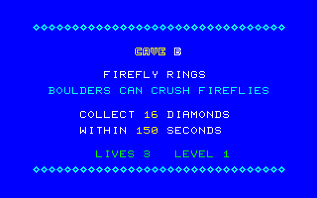
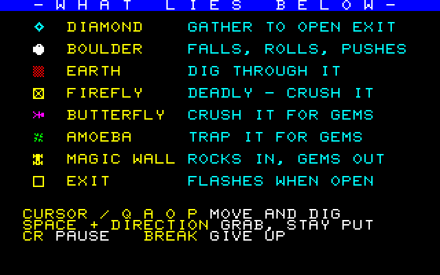

# ROCKFALL

A cave-digging game for the **Sharp MZ-700** (64K, PAL, stock European
character ROM, no PCG), loaded from tape or a UniCMT USB cassette emulator.

Deep under the mountain lie sixteen caves full of diamonds. Dig through the
earth, gather enough diamonds to open the exit, and get out before the clock
runs down. Boulders fall when you dig beneath them and roll off anything
round. Fireflies explode at a touch, butterflies burst into diamonds, the
amoeba grows, and the magic wall turns falling rocks into gems.

 
 

`docs/title_music.wav` is the title music as recorded from the simulator's
sound chip.

## Running it

- **Real MZ-700 / UniCMT:** copy `release/ROCKFALL.MZF` to the USB stick and
  load it like a tape (`L` from the monitor). It loads at 1200h and starts by
  itself.
- **Emulator:** open `release/ROCKFALL.MZT` (the same file with the extension
  MZ700WIN expects).

## Controls

| Key | Action |
|---|---|
| Cursor keys or Q / A / O / P | move and dig |
| SPACE + direction | grab earth or a diamond next to you without moving |
| LEFT / RIGHT on the title | choose the starting cave (A, E, I or M) |
| CR | pause |
| BREAK | give up |

## Playing

- The top line shows the diamonds needed, the value of each diamond, the
  diamonds you have, the time, your score, lives, and the cave and level.
- When you have enough diamonds the empty space flashes and the exit opens.
  Diamonds collected after that are worth more.
- Boulders and diamonds at rest do not hurt you. A **falling** one does.
  Push a boulder sideways by walking into it (it may take a few tries).
- **Fireflies** (yellow boxes) kill you if they touch you. Drop a rock on one
  and it explodes. **Butterflies** (magenta) explode into nine diamonds.
- The **amoeba** grows into earth and space. Box it in and it turns to
  diamonds. Let it grow too big and it turns to stone.
- The **magic wall** looks like brick until a rock falls on it. For a while
  after that, boulders that fall through come out as diamonds (and diamonds
  as boulders).
- Remaining time is added to your score when you leave a cave. An extra life
  every 500 points. After cave P the caves start again at the next level,
  with less time and faster physics.

## Attract mode

Title screen with music, a colour-cycling logo, a little digger tunnelling
along the bottom and a scroller, then a guide to what lives in the caves, the
high-score table, and a **demo game** played by an AI pilot. The pilot runs a
breadth-first search through earth and space to the nearest diamond (then
the exit), avoiding creatures and falling rocks. Press any key to leave the
demo.

## Building

Needs Python 3 and Pillow (for screenshots); sjasmplus is in `tools/`.

```
py build.py                     generate data, assemble, write build/ and release/
py tools/test_game.py           scripted physics checks (all should pass)
py tools/cave_test.py ABC 2     let the pilot play caves, two tries each
py tools/test_demo.py 6000 500  watch the attract mode and demo
py tools/perf.py all 800        game speed under a conservative VRAM wait model
py tools/preview.py             render every cave to build/cave_X.png
py tools/reach.py               diamonds and exit in reach of the start, per cave
py tools/wav.py 40              render the title music to build/title_music.wav
```

The simulator needs the MZ-700 character ROM as `rom/mz700fon.int` (not
included).

| Path | What |
|---|---|
| `src/main.asm` | entry, attract loop, memory map |
| `src/cave.asm` | cave unpacking and the physics scan |
| `src/player.asm` | controls, the player's move, scoring |
| `src/pilot.asm` | the demo's AI pilot |
| `src/render.asm` | cave view, reveal / cover dissolve, HUD |
| `src/game.asm` | game flow, clock, cave cards, game over |
| `src/screens.asm` | title, guide, high scores |
| `src/sound.asm` | one-voice music player and effects |
| `tools/caves.py` | element codes, tile looks and the 16 cave designs |
| `tools/music.py` | the songs and sound effects |

## How it works

- **One cell per tile.** Each cave is 40 x 22 cells, so a whole cave fits on
  the text screen with the HUD above and the cave name below; there is no
  scrolling. Tiles are character-ROM glyphs with colour.
- **Physics** is a top-to-bottom scan once per tick (8 per second). An object
  that moves right or down is written with a "moved" bit so the scan skips
  it. Falling and rolling, explosions, firefly/butterfly wall following,
  amoeba growth and the magic wall all work this way.
- **Rendering.** Each element maps through a phase table to a display index
  (so diamonds sparkle and fireflies spin), and only cells whose display
  index changed are written to VRAM. Under the VRAM wait model under 2% of
  the CPU goes on waits.
- **Caves** are drawn in Python from a seeded random fill plus lines, boxes
  and points, checked for enough diamonds, and stored as 4-bit cells (380
  bytes each).
- The demo pilot slows the attract demo to about 7.5 ticks per second when its
  search is long. The game itself runs at full speed.
