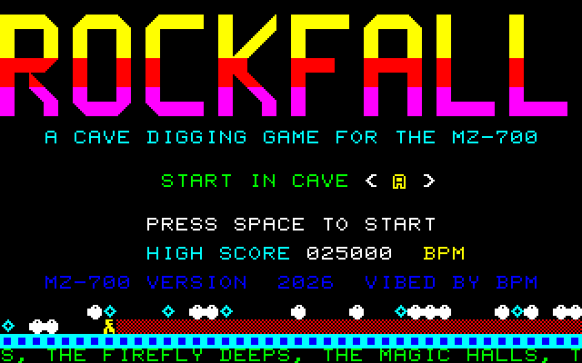
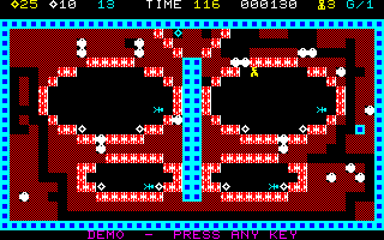

# ROCKFALL

A cave-digging game for the **Sharp MZ-700** (64K, PAL, stock European
character ROM, no PCG), loaded from tape or a UniCMT USB cassette emulator.

Deep under the mountain lie twenty caves in five wings. Dig through the
earth, gather enough diamonds to open the exit, and get out before the clock
runs down. Boulders fall when you dig beneath them and roll off anything
round. Fireflies explode at a touch, butterflies burst into diamonds, the
amoeba grows, the magic wall turns falling rocks into gems, and spouts in
the ceiling rain jewels.

 
 

`docs/title_music.wav` is the title music as recorded from the simulator's
sound chip.

## Running it

- **Real MZ-700 / UniCMT:** copy `release/ROCKFALL.MZF` to the USB stick and
  load it like a tape (`L` from the monitor). It loads at 1200h and starts by
  itself.
- **Emulator:** open `release/ROCKFALL.MZT` (the same file with the extension
  MZ700WIN expects).

## Controls

| Key | Action |
|---|---|
| Cursor keys or Q / A / O / P | move and dig |
| SPACE + direction | grab earth or a diamond next to you without moving |
| LEFT / RIGHT on the title | choose the starting wing (cave A, E, I, M or Q) |
| CR | pause |
| BREAK | give up |

## The caves

Like Cryptfall, the caves are planned in wings. Each wing teaches one idea,
varies it, shows it off in a **picture cave** (every cave fits the screen,
so you always see the whole picture), and ends in a **jewel shower**: a
collect-em-up where spouts in the ceiling rain gems, with more falling
hazards in each later wing. Each cave's card names its wing and gives a
one-line hint.

| Wing | Teach | Vary | Picture | Shower |
|---|---|---|---|---|
| I The Shallows | A First Light: dig and gather | B Rolling Stones: rocks roll off round things | C The Mountain | D Jewel Shower: gems only, falling through a giant gem of pegs |
| II Firefly Deeps | E Lanterns: drop a rock on a firefly to blast its vault | F Butterfly Pens: drop rocks through the roof slots | G The Moth: butterflies in its wings | H Sparkfall: gems and rocks, fireflies in the floor |
| III Magic Halls | I The Magic Wall | J Alchemy Shafts: open the shafts from the gallery | K Hourglass: snap the plug and the stone sand runs through the magic neck | L Rock Rain: a stone storm turned to gems by a magic floor |
| IV Green Caverns | M The Amoeba: gather before it spreads | N Creeping Walls | O The Tree: fruit in the crown, amoeba at the roots | P Emerald Rain: catch the rain before the amoeba |
| V The Core | Q Gauntlet: firefly tunnels | R Twin Vaults: feed the magic roofs | S Treasure Storm: under a crown of pegs | T The Core: everything you have learned |

**Every cave is proven completable.** A solving bot plays each cave on an
exact Python model of the rules. It plans paths, tries them in a copy of the
world, and keeps a move only if it survives. It also times rock drops onto
creatures: it waits beside an earth plug and snaps it away at the moment
that frees the most gems. Each winning run is stored in
`tools/solutions.py`, and each cave's clock is set from it (twice the bot's
time plus 40 s). `build.py` refuses to build if any solution stops winning.
`tools/verify.py` plays every solution on the real Z80 program in the
simulator and compares the whole cave with the model after every tick.

## Playing

- The top line shows the diamonds needed, the value of each diamond, the
  diamonds you have, the time, your score, lives, and the cave and level.
- When you have enough diamonds the empty space flashes and the exit opens.
  Diamonds collected after that are worth more.
- Boulders and diamonds at rest do not hurt you. A **falling** one does.
  Push a boulder sideways by walking into it for two moves running.
- **Fireflies** (yellow boxes) kill you if they touch you. Drop a rock on one
  and it explodes. **Butterflies** (magenta) explode into nine diamonds. Both
  follow walls: a butterfly circles a room along its walls.
- The **amoeba** grows into earth and space. Box it in and it turns to
  diamonds. Let it grow too big and it turns to stone.
- The **magic wall** looks like brick until a rock falls on it. For a while
  after that, boulders that fall through come out as diamonds (and diamonds
  as boulders).
- **Spouts** (the domes in the ceiling) rain gems, and in later wings rocks
  too, until they run dry.
- Remaining time is added to your score when you leave a cave. An extra life
  every 500 points. After cave T the caves start again at the next level,
  with less time and faster physics.

## Attract mode

Title screen with music, a colour-cycling logo, a little digger tunnelling
along the bottom and a scroller. Then come a guide to what lives in the
caves, the high-score table and a **demo**. The demo replays a cave's
recorded solution, a different cave each time: the jewel shower, the moth,
the hourglass and more. The rules are deterministic, so the replay plays out
exactly as it did for the bot. Press any key to leave the demo.

## Building

Needs Python 3 and Pillow (for screenshots); sjasmplus is in `tools/`.

```
py build.py                     generate data, check every solution, assemble, write build/ and release/
py tools/bot.py [letters]       let the solving bot play caves on the Python model
py tools/tune.py [letters]      solve caves, set their clocks, save tools/solutions.py
py tools/verify.py [letters]    play the solutions on the Z80 build, compared tick by tick
py tools/crosscheck.py 0,4 400  random play: Z80 and Python model compared every tick
py tools/test_game.py           scripted physics checks (all should pass)
py tools/sheet.py               all caves on one contact sheet (build/caves_sheet.png)
py tools/perf.py all 800        game speed under a conservative VRAM wait model
py tools/wav.py 40              render the title music to build/title_music.wav
```

The simulator needs the MZ-700 character ROM as `rom/mz700fon.int` (not
included).

| Path | What |
|---|---|
| `src/main.asm` | entry, attract loop, memory map |
| `src/cave.asm` | cave unpacking, the physics scan, the spouts, the cave's random numbers |
| `src/player.asm` | controls, the player's move, scoring, demo replay |
| `src/render.asm` | cave view, reveal / cover dissolve, HUD |
| `src/game.asm` | game flow, the tick and clock, cave cards, game over |
| `src/screens.asm` | title, guide, high scores |
| `src/sound.asm` | one-voice music player and effects |
| `tools/cavelist.py` | the 20 cave designs, wing by wing |
| `tools/caves.py` | element codes, tile looks, drawing brushes |
| `tools/engine.py` | the rules in Python, tick for tick like the Z80 |
| `tools/bot.py`, `tools/tune.py`, `tools/solutions.py` | the solver, the tuner, the solutions |
| `tools/music.py` | the songs and sound effects |

## How it works

- **One cell per tile.** Each cave is 40 x 22 cells, so a whole cave fits on
  the text screen with the HUD above and the cave name below, with no
  scrolling. Tiles are character-ROM glyphs with colour.
- **Physics** is a top-to-bottom scan once per tick (8 per second). An object
  that moves right or down is written with a "moved" bit so the scan skips
  it. Falling and rolling, explosions, firefly/butterfly wall following,
  amoeba growth, the magic wall and the spouts all work this way.
- **Deterministic.** Amoeba growth and the spouts draw on the cave's own
  random sequence: a xorshift seeded per cave, never the Z80's R register.
  A push succeeds on the second tick of pushing. Every timer counts ticks.
  So the same keys always give the same game, which is what makes the
  recorded solutions and the demo replays possible.
- **Rendering.** Each element maps through a phase table to a display index
  (so diamonds sparkle and fireflies spin), and only cells whose display
  index changed are written to VRAM. Under the VRAM wait model, VRAM waits
  take less than 2% of the CPU.
- **Caves** are painted in Python with brushes (boxes, ellipses, stamps,
  pegs, spouts, rock drops over earth plugs) on a seeded random fill, and
  stored as 4-bit cells (380 bytes each).
