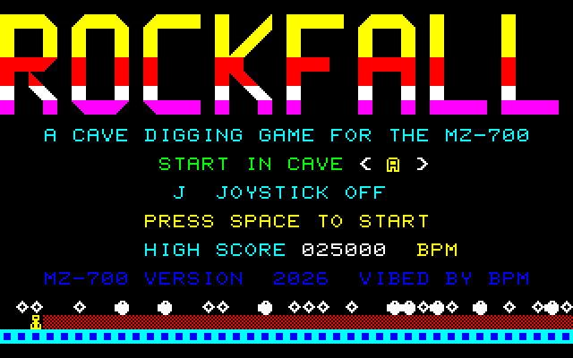
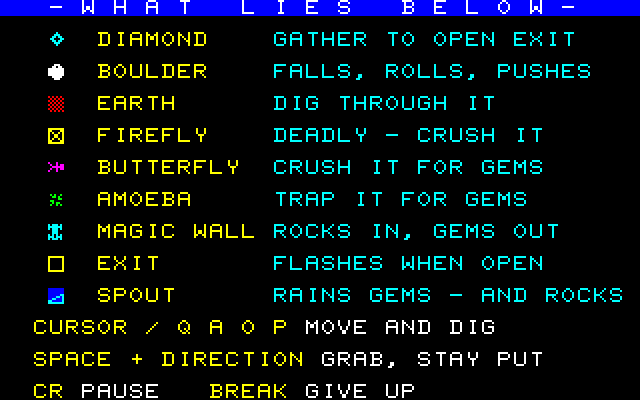
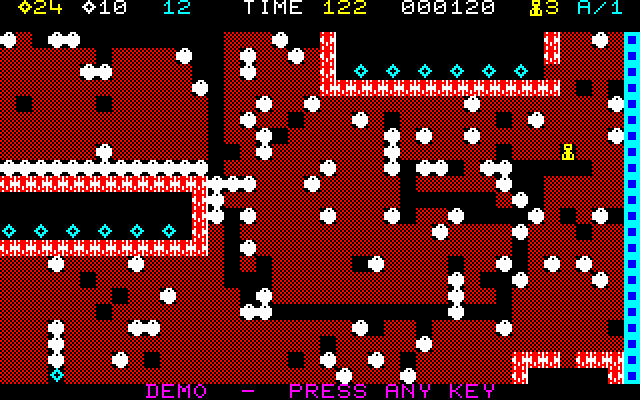
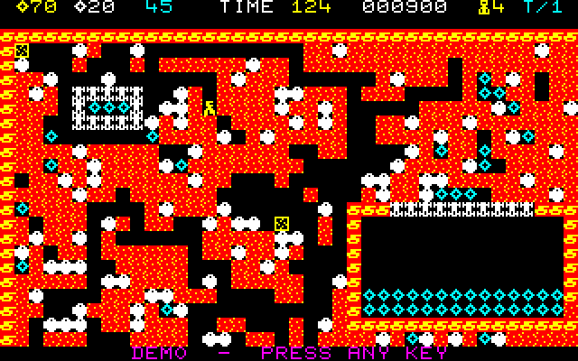
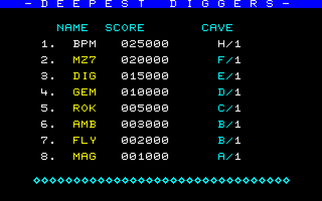

# ROCKFALL

*A cave-digging game for the Sharp MZ-700.*
ViBED by BPM 2026.

**Deep under the mountain lie twenty caves, and the diamonds won't dig
themselves out.** Tunnel through the earth, gather enough gems to open the
exit, and get out before the clock runs down. Every rock you dig beneath
falls, and anything round rolls. Fireflies explode at a touch, butterflies
burst into showers of diamonds, the amoeba creeps through the earth, the
magic wall turns falling stone into gems, and spouts in the ceiling rain
jewels on your head.

The caves are bigger than the screen. Most are a full 64 x 32 cells, and the
view glides after you as you dig. They come in five wings, each with its
own stone and colours, from the red earth of the Shallows to the molten
Core. Each wing teaches one idea, twists it, shows it off in a picture cave
(a mountain, a moth, an hourglass, a tree) and ends in a jewel shower.
The first cave already bites. A careless digger is under a rock within
seconds, and the second try goes better.

| | |
|---|---|
|  |  |
|  |  |
|  |  |
|  |  |
|  |  |

## Twenty caves in five wings

- **I The Shallows:** gems hanging under rock columns, heaps and toppling
  pillars, the Mountain, and a jewel shower through a giant gem of pegs.
- **II Firefly Deeps:** drop rocks on fireflies to blast their vaults open,
  and free the butterflies sleeping in the Moth's wings.
- **III Magic Halls:** feed boulders to the magic wall. Snap the plug and
  the Hourglass's stone sand runs through a magic neck into diamonds.
- **IV Green Caverns:** box in the amoeba before it spreads, and pick the
  Tree's fruit before its roots creep up.
- **V The Core:** firefly gauntlets, twin vaults, a treasure storm, and
  the Core itself: everything you have learned.

Start in any wing from the title. Clear cave T and the caves start again,
with less time and faster rocks.

## All the trimmings

- **Attract sequence:** "Under the Mountain" title music, a colour-rolling
  logo, a digger tunnelling along the bottom and a scroller. Then a guide
  to everything in the caves, the Deepest Diggers table, and a demo.
- **Demo:** the computer plays a different cave each time, replaying the
  solving bot's winning run move for move.
- **Cave cards:** each names its wing and gives a one-line hint, then
  the cave dissolves into view.
- **Scoring:** diamonds worth more once the exit is open, the time left
  added to your score, an extra life every 500 points, and a high-score
  table with initials.
- **Sound:** four tunes and sixteen sound effects. Rocks land, gems
  chime, fireflies boom and the exit fanfares.
- **Controls:** the keyboard, or a Sharp MZ-1X03 joystick (press J on the
  title). SPACE or a button with a direction grabs without moving.
- **Proven completable:** a solving bot has won every cave on an exact
  model of the rules. Its runs replay and win on the real Z80 program, and
  each cave's clock is set from them.

## Technical specifications

| | |
|---|---|
| Machine | Sharp MZ-700, stock: Z80A at 3.5 MHz, 64 KB RAM, PAL |
| Display | 40 x 25 text, 8 colours, built-in European character ROM only (no PCG, no bitmap mode) |
| Graphics | One ROM character and colour pair per cell, 74 looks across five wing themes; diamonds sparkle and fireflies spin through phase tables |
| View | A 40 x 22 window on caves up to 64 x 32 cells. It stays still until you near an edge, then glides a cell per frame |
| Screen updates | A shadow copy of the window means only cells whose look changed are written to video RAM |
| Physics | A top-to-bottom scan of the whole cave, not just the window, every tick: falling, rolling, pushing, explosions, wall-following creatures, amoeba, magic wall, spouts |
| Speed | 25 display frames a second; 8 to 12 game ticks a second, depending on the cave. The busiest cave holds full speed under a pessimistic video-memory wait model (about 3% of the CPU lost to waits) |
| Timing | Frames are paced with the 8253's scan-line counter, synchronised to VBLANK, so a long frame doesn't lose a field |
| Determinism | Each cave has its own seeded random sequence and every timer counts ticks, so the same keys always give the same game |
| Sound | One 8253 square-wave voice shared by the music player and the effects |
| Controls | Cursor keys or Q / A / O / P; optional Sharp MZ-1X03 joystick, its analogue pulses timed from VBLANK on the scan-line counter (about 2% of the CPU when on) |
| Cave data | 20 caves, Huffman-coded with a code tree per cave: 7,289 bytes (about 350 bytes for a full 64 x 32 cave) |
| Demo data | The recorded solutions, run-length coded: 4,418 bytes |
| Media | `ROCKFALL.MZF` for a real machine through a UniCMT or tape; `ROCKFALL.MZT` for emulators (identical) |
| File | 27,813 bytes; loads at 1200h and starts by itself; nothing more is loaded |
| Language | Z80 assembly (sjasmplus); cave design, solver, music and verification in Python |

### RAM used

| Area | Address | Bytes |
|---|---|---|
| Program, caves, themes, music, demo | 1200h-7EA4h | 27,813 |
| Variables and high-score table | 7F00h-80A0h | 417 |
| The current cave, unpacked (64 x 32) | B800h-BFFFh | 2,048 |
| Screen shadow (40 x 22) | C050h-C3BFh | 880 |
| Stack (top) | below CFF0h | 256 |
| **Total** | | **about 31,400 (30.7 KB)** |

That leaves roughly 16 KB of the MZ-700's 47.5 KB of user RAM (1200h-CFFFh)
free. Video and colour RAM (D000h-DFFFh) and the monitor ROM are not
counted.

Not yet played on a real MZ-700: everything above was measured in a cycle-
counted simulator, which also replays every cave's solution to a win.
