# UNDERMINED

*A cave-digging game for the Sharp MZ-700.*
ViBED by BPM 2026.

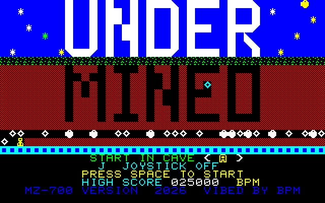

**Deep under the mountain lie twenty-six caves in seven wings, and the
diamonds won't dig themselves out.** Tunnel through the earth, gather enough gems to open the
exit, and get out before the clock runs down. Every rock you dig beneath
falls, and anything round rolls. Fireflies explode at a touch, butterflies
burst into showers of diamonds, the amoeba creeps through the earth, the
magic wall turns falling stone into gems, and spouts in the ceiling rain
jewels on your head. Deeper still, falling rocks crack geodes open, rocks
seep through slime, a single key opens every lock, and shades, ghosts that
follow the tunnels you dig, wait to be crushed.

The caves are bigger than the screen. Most are a full 64 x 32 cells, and the
view glides after you as you dig. They come in seven wings, each with its
own stone and colours, from the red earth of the Shallows through the
molten Core and the ice of the Crystal Vaults to the Haunted Deep. Each wing
teaches one idea, twists it, and shows it off in a picture cave: a
mountain, a moth, an hourglass, a tree, a giant crystal, the heart of the
mountain itself. Between the wings lie six hidden chambers in gold: quick
dashes for gems that cost no life.
The first cave already bites. A careless digger is under a rock within
seconds, and the second try goes better.

| | |
|---|---|
| 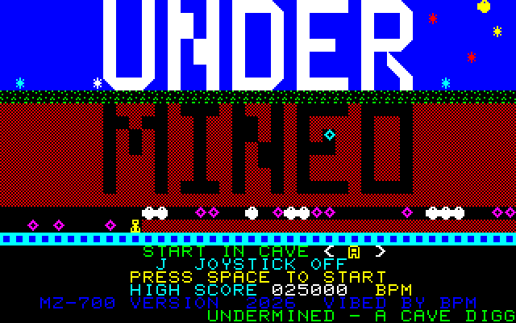 | 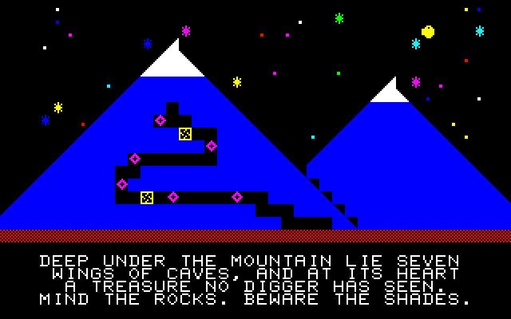 |
| 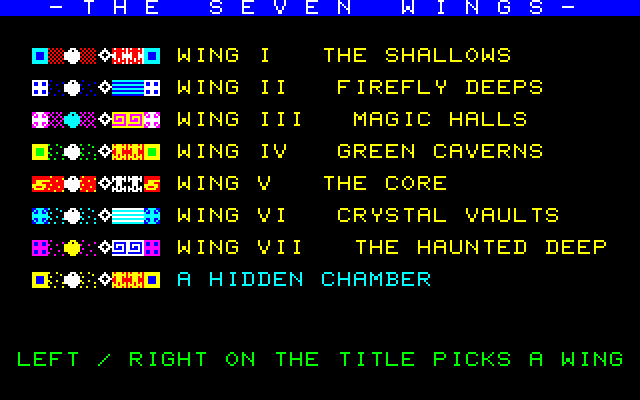 | 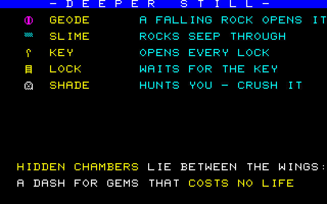 |
|  | 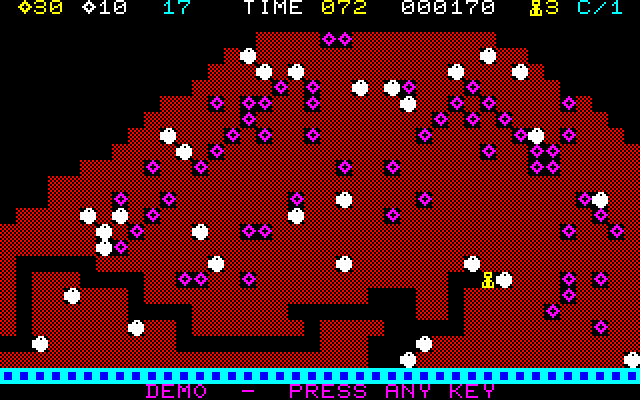 |
| 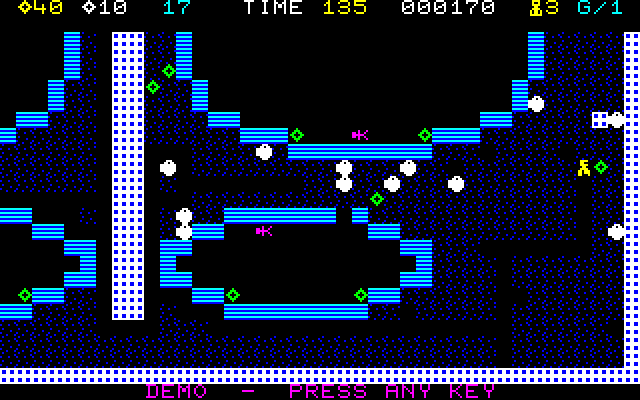 | 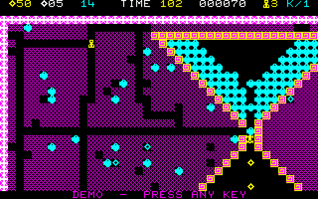 |
| 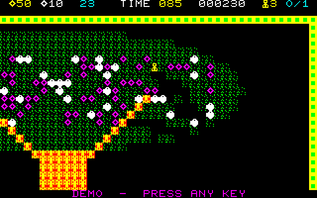 |  |
| 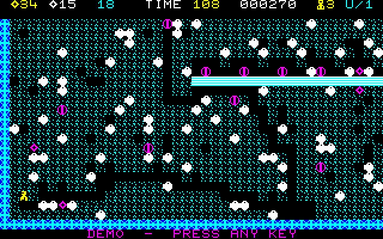 | 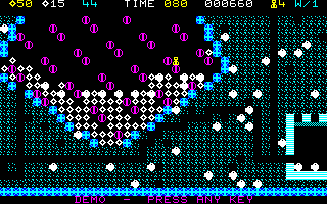 |
| 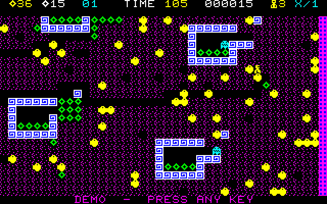 | 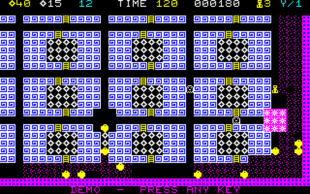 |
| 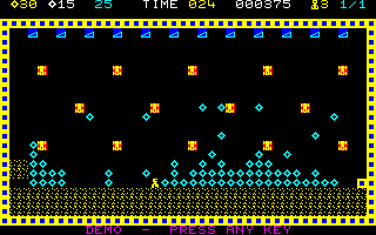 | 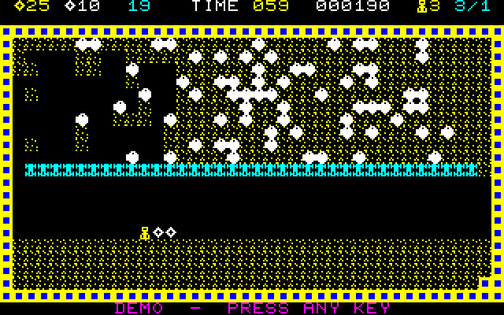 |
| 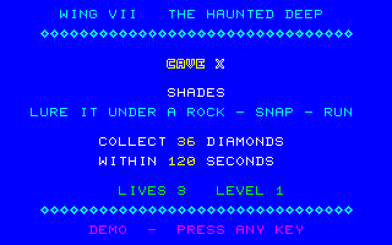 | 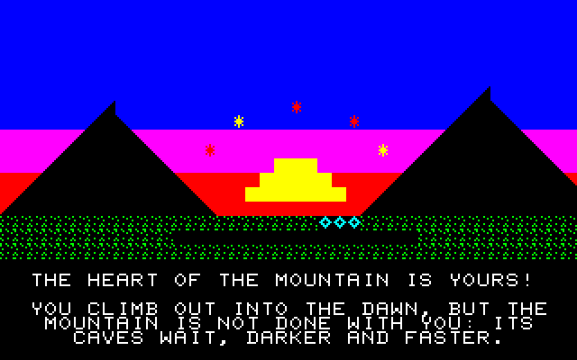 |

## Twenty-six caves in seven wings

- **I The Shallows:** gems hanging under rock columns, heaps and toppling
  pillars, the Mountain, and a jewel shower through a giant gem of pegs.
- **II Firefly Deeps:** drop rocks on fireflies to blast their vaults open,
  and free the butterflies sleeping in the Moth's wings.
- **III Magic Halls:** feed boulders to the magic wall. Snap the plug and
  the Hourglass's stone sand runs through a magic neck into diamonds.
- **IV Green Caverns:** box in the amoeba before it spreads, and pick the
  Tree's fruit before its roots creep up.
- **V The Core:** firefly gauntlets, twin vaults, a treasure storm, and
  the Core itself: everything you have learned.
- **VI Crystal Vaults:** geodes hanging under rock columns, halls with
  slime floors that rocks seep through, and a giant locked crystal whose
  key lies far away under slime.
- **VII The Haunted Deep:** lure each shade out of its crypt under a rock,
  snap the earth and run; catacombs of locked tombs where the dead walk;
  and the Heart of the Mountain.

Six hidden chambers lie between the wings: Crystal Rain, Butterfly
Garden, the Alchemist's Vat, the Honeycomb, Geode Field and the Treasure
Vault. Start in any wing from the title. Clear cave Z and you climb out of
the mountain at daybreak, then the caves start again, darker and faster.

## All the trimmings

- **Attract sequence:** "Under the Mountain" title music and the name
  split by the ground: UNDER against a starry sky, MINED dug into the earth
  below, with a little digger tunnelling underneath and a scroller. Then two tours
  in turn. "The Legend" shows the mountain by night to a slow hymn: stars
  twinkle, lanterns flicker in its caves, a miner walks home, and the story
  types itself out. "The Seven Wings" shows each wing's stone and gems,
  animated. Each tour has its guide to what lives in the caves, then the
  Deepest Diggers table and a demo.
- **Demo:** the computer plays a different cave each time, replaying the
  solving bot's winning run move for move.
- **Cave cards:** each names its wing, gives a one-line hint and plays the
  wing's own jingle, then the cave dissolves into view.
- **Ending:** "Daybreak": out of the mountain into a sunrise, with its own
  tune.
- **Scoring:** diamonds worth more once the exit is open, the time left
  added to your score, an extra life every 500 points, and a high-score
  table with initials.
- **Sound:** five tunes (title, hymn, daybreak, name entry, game over),
  eight cave-card jingles and eighteen sound effects. Rocks land, gems chime,
  geodes crack, keys ring, fireflies boom and the exit fanfares.
- **Controls:** the keyboard, or a Sharp MZ-1X03 joystick (press J on the
  title). SPACE or a button with a direction grabs without moving.
- **Proven completable:** a solving bot has won every cave on an exact
  model of the rules. Its runs replay and win on the real Z80 program, and
  each cave's clock is set from them.

## Technical specifications

| | |
|---|---|
| Machine | Sharp MZ-700, stock: Z80A at 3.5 MHz, 64 KB RAM, PAL |
| Display | 40 x 25 text, 8 colours, built-in European character ROM only (no PCG, no bitmap mode) |
| Graphics | One ROM character and colour pair per cell, 94 looks across eight themes (seven wings and the gold bonus chambers); diamonds sparkle, fireflies spin and shades flicker through four-phase tables. Full-screen pictures for the story and the ending, run-length packed into 791 bytes |
| View | A 40 x 22 window on caves up to 64 x 32 cells. It stays still until you near an edge, then glides a cell per frame |
| Screen updates | A shadow copy of the window means only cells whose look changed are written to video RAM |
| Physics | A top-to-bottom scan of the whole cave, not just the window, every tick: falling, rolling, pushing, explosions, wall-following creatures, amoeba, magic wall, spouts, geodes, slime, locks and hunting shades. A cell holds a 6-bit element and a moved-this-tick flag |
| Speed | 25 display frames a second; 8 to 12 game ticks a second, depending on the cave. The busiest caves hold full speed, or within 1% of it, under a pessimistic video-memory wait model (about 3% of the CPU lost to waits) |
| Timing | Frames are paced with the 8253's scan-line counter, synchronised to VBLANK, so a long frame doesn't lose a field |
| Determinism | Each cave has its own seeded random sequence and every timer counts ticks, so the same keys always give the same game |
| Sound | One 8253 square-wave voice shared by the music player and the effects |
| Controls | Cursor keys or Q / A / O / P; optional Sharp MZ-1X03 joystick, its analogue pulses timed from VBLANK on the scan-line counter (about 2% of the CPU when on) |
| Cave data | 32 caves, Huffman-coded with a code tree per cave: 10,850 bytes (about 350 bytes for a full 64 x 32 cave) |
| Demo data | Every cave's recorded solution, run-length coded: 7,044 bytes |
| Media | `UNDERMINED.MZF` for a real machine through a UniCMT or tape; `UNDERMINED.MZT` for emulators (identical) |
| File | 40,458 bytes; loads at 1200h and starts by itself; nothing more is loaded |
| Language | Z80 assembly (sjasmplus); cave design, solver, music and verification in Python |

### RAM used

| Area | Address | Bytes |
|---|---|---|
| Program, caves, themes, music, pictures, demo | 1200h-B009h | 40,458 |
| Variables and high-score table | B100h-B2B9h | 442 |
| The current cave, unpacked (64 x 32) | B800h-BFFFh | 2,048 |
| Screen shadow (40 x 22) | C050h-C3BFh | 880 |
| Stack (top) | below CFF0h | 256 |
| **Total** | | **about 44,100 (43.1 KB)** |

That leaves about 4.4 KB of the MZ-700's 47.5 KB of user RAM (1200h-CFFFh)
free, in gaps between the areas above. Video and colour RAM (D000h-DFFFh) and the monitor ROM are not
counted.

Not yet played on a real MZ-700: everything above was measured in a cycle-
counted simulator, which also replays every cave's solution to a win.
