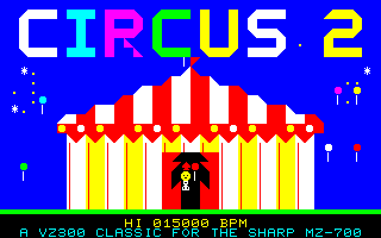
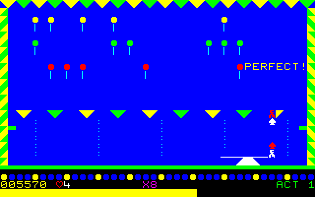
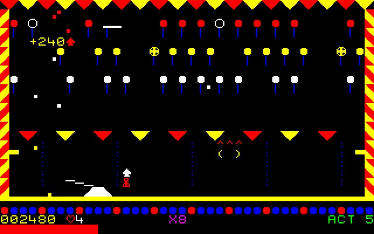
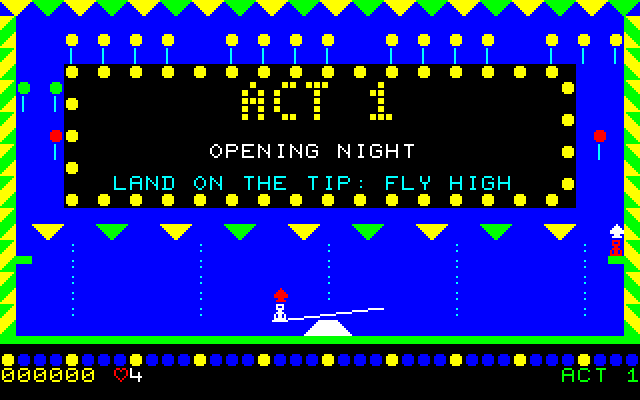
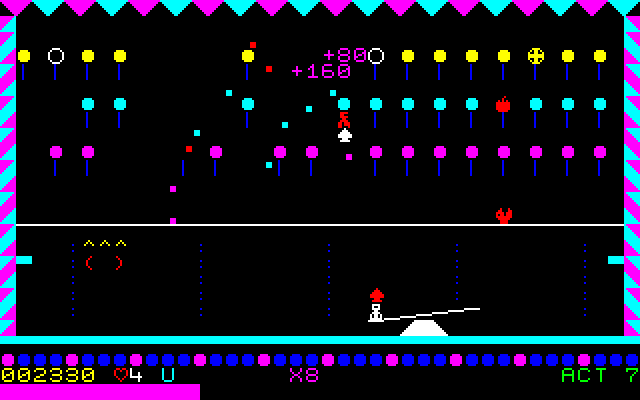
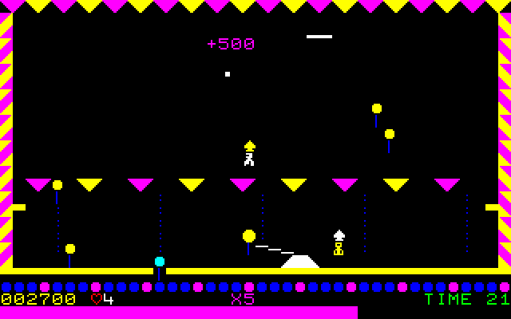

# CIRCUS 2 for the Sharp MZ-700

The MZ-700 conversion of **Circus 2**, the deluxe VZ200/VZ300 sequel to the
classic *Circus*. The core is the same seesaw-and-balloons game: slide the
seesaw, catch the falling clown on the raised end, and his partner flies
into the balloons. Around it there are nine themed acts, two bonus rounds,
seven power-ups, combos, a monkey with custard pies, a ring of fire, the
circus march and an attract mode with an AI demo.

Runs on a stock **64K PAL Sharp MZ-700** with the standard European
character ROM. No PCG is needed. *Vibed by BPM 2026.*

 
 
 

The title music is in `docs/title_music.wav` (recorded from the simulator).

## Loading

- **Real MZ-700 with a UniCMT (or tape):** copy `release/CIRCUS2.MZF` to the
  stick and load it from the monitor with `L`. It loads at 1200h and starts
  by itself.
- **Emulator (e.g. MZ700WIN):** open `release/CIRCUS2.MZT`, which is the
  same file.

The game takes over the machine. Reset to leave.

## Controls

| Key | Action |
|---|---|
| Z / X or cursor left / right | slide the seesaw |
| SPACE, CR or cursor up | flip the seesaw |
| P or BREAK | pause. While paused: P plays on, S toggles sound, Q quits to the title |
| S on the title | sound on / off |
| D on the title | level: Easy / Normal / Hard (5 / 4 / 3 lives, slower or faster balloons) |
| SPACE (or any other key) on the title | start |
| letters, CR, cursor left | type your name in the high-score table |

## How it plays

Slide the seesaw so the falling clown lands on the **raised** end. The
other clown is catapulted into the balloons. **Where** he lands sets the
height of the launch:

- near the pivot: a weak hop that reaches the lowest row
- the middle of the plank: a medium launch
- the tip: **PERFECT!** A big launch that hits the roof and pops balloons
  on the way down too

Holding left or right as he lands steers the launch. Flipping the seesaw
lets you catch on either side. A clown who drops onto the occupied end
gets a **BONK!** and a second chance. Miss the plank and it's **OUCH!**
(one life). Pop every balloon to clear the act.

**Scoring**
- Balloons are worth more the higher their row. Each pop in an unbroken
  chain multiplies its value, up to x8. A flight with no pops ends the chain.
- Every 5 catches in a row: a streak bonus and a confetti burst.
- Clearing a row: **ROW CLEAR!** +500.
- Finishing an act without a fall: **NO FALLS** +5000.
- An extra life every 20,000 points.

**Special balloons**
- Striped **gift** balloons drop a power-up. Catch it on the plank or touch
  it with a clown.
- **Bombs** (with a fuse) pop their neighbours, and the balloons above and below.
- **Steel** rings take two hits.
- **Gold** balloons in the bonus rounds are worth 500.

**Power-ups** (shown on the status line, blinking as they run out):
W wide seesaw, S slow motion, N safety net (stacks to 3), 2 double points,
U umbrella (slow descent), F fireworks (pops six random balloons), 1 extra life.

**The acts**
1. Opening Night: the original game's yellow, green and red balloons, on a night-blue ring
2. Gifts Galore
3. Monkey Business: pies make the seesaw sticky. Bonk the monkey for 250.
4. Bonus: Balloon Bonanza. 30 seconds, balloons float up, and falls don't count.
5. Ring of Fire: fly through the hoop for 300 and a combo step. The rim is hot.
6. Bombs Away: four rows, with bombs and steel
7. The Night Show: bobbing rows, the monkey and the hoop
8. Bonus: Prize Pop
9. Grand Finale

After act 9 comes the **ENCORE**: the show starts again with faster rows,
and the act numbers keep counting.

## Presentation

- **Title:** the big top with a colour-cycling logo, chasing marquee bulbs,
  twinkling stars, a winking clown in the tent door and balloons floating
  up beside the tent. The circus march from the VZ game plays, and the
  bottom line cycles the high score, options, keys and credits.
- **Attract sequence:** title, AI demo (a different act each lap), How to
  Play, Goodies, Top Clowns, Coming Up, then the title again. Any key starts
  a game, including during the demo.
- **Act cards** open behind theatre curtains, to the Circus jingle.
  Curtains close at the end of each act.
- **Colours:** the MZ-700 has only eight full-brightness colours, so every
  arena (and the info pages) sits on black or blue. Each act's character
  comes from its balloons, canopy, tent poles and bunting.
- **In the ring:** a zig-zag valance, bunting or the monkey's tightrope,
  rolling barber-pole tent poles, chasing floor lights, canvas seams,
  particle bursts and confetti at half-cell resolution, and rising score
  pop-ups.
- **Celebrations:** BRAVO! with confetti and a fanfare when an act is
  cleared. GAME OVER gets the sad trombone, then high-score entry for the
  top five.

## How the conversion works

The VZ300 game draws pixel sprites on a 128x64 bitmap. The MZ-700 has only
a 40x25 character screen, so this version is built from character-ROM
glyphs:

- A clown is two cells: a spade for the pointed hat over one of the CG-ROM's
  little men (arms up, arms out, waving). A PERFECT launch makes him
  somersault, and with the umbrella power-up he floats down under the ROM's
  umbrella glyph.
- Balloons are filled circles with strings. Gifts use the striped ball,
  bombs the round bomb with a fuse, and steel balloons the ring glyph.
- The plank is a staircase of the eight single-line glyphs (one for each
  pixel row), so it slopes smoothly across two character rows.
- The big dotted lettering (act cards, BRAVO!, GAME OVER) is a 3x5 font
  built from the quarter-dot glyphs F0h-FFh. Particles use the same specks
  at half-cell resolution.
- Physics runs in sub-cell fixed point (x in quarter cells, y in pixels,
  8.8) at 25 updates a second with two substeps, scaled from the VZ
  constants. The launch speeds are tuned so the weak, medium and PERFECT
  launches reach the same rows they reach on the VZ. Collisions use the
  cells the player can see.
- **Compositor:** the background (canopy, poles, balloon rows, HUD) is
  kept in RAM. Each frame the moving objects are put into a cell list, and
  only cells that differ from a shadow copy of the screen are written to
  VRAM, mostly during vertical blanking.
- **Sound:** the MZ-700 has one square-wave voice (8253 counter 0). The
  VZ game's two-voice tunes are rearranged for a tracker-style player that
  shares the voice between drums, a bass pluck and the lead, with arpeggios.

## Building

Needs Python 3 (Pillow only for the screenshot tools) and sjasmplus
(copied in `tools/sjasmplus/`).

```
py build.py
```

This writes `build/CIRCUS2.MZT` and `.MZF` and copies them to `release/`.
`build.py` generates the tables in `build/gen_*.inc`: the character
tables, the acts converted from the VZ act data (16 balloon slots per row
become 20), the music, the title picture and the big font.

### Memory map

| Address | Use |
|---|---|
| `1200h-5AD1h` | code and data (the file image) |
| `5B00h-...` | variables |
| `A000h-AFFFh` | background chars and attrs, shadow chars and attrs |
| `B000h-B3E7h` | object map |
| `B400h-BCFFh` | object cell lists, dirty rows and dirty cells |
| `C000h-CCFFh` | curtain reveal buffer and the arena under the act card |
| `CFF0h` | stack top |

## Testing (in the simulator)

`tools/` has a Python Z80 + MZ-700 model (`z80.py`, `mzsim.py`). It needs
the European CG-ROM image at `rom/mz700fon.int`, which is not included.

- `tools/test_game.py`: the demo pilot plays real games from the title at
  full speed, and the log records every act, life and the final score.
- `tools/test_frontend.py`: title options, pause, losing a game and
  typing a name into the high-score table.
- `tools/perf.py`: frame timing per act with the VRAM wait-state model.
- `tools/soak.py`: a long attract-mode run with crash and compositor checks.
- `tools/scorecheck.py`: the score matches the points awarded.
- `tools/run.py`: run with scripted keys and take screenshots.

Results so far (all on the release build):

- The pilot played from the title with lives topped up. It cleared all
  nine acts, including both bonus rounds, and went on into the encore:
  267,880 points by Encore Act 2, with 1 late frame in 22,575 fields.
  Played straight, it loses its four lives in Act 1, because it always aims
  for the risky tip.
- `tools/scorecheck.py` checked that the score only ever grows by the
  points the game awards, from the Act 4 bonus round through Act 8, and
  again from Act 8 into the encore.
- A soak test ran 30,000 fields (10 minutes) of the attract mode, with
  demos of seven different acts. There were no crashes, the stack stayed
  in range, and no object cells were left behind.
- Front end: the title options, pause and sound toggle, game over, and a
  name typed into first place in the high-score table all worked.
- Timing with the VRAM wait model: acts 1 and 6 had 1 late frame in 750
  updates, and act 9, the busiest, had 4.

## Known limitations

- **Not yet tested on real hardware.** Timing was checked only with the
  simulator's VRAM wait model.
- **High scores** are kept until reset. They are not saved to tape.
- There is no in-game music, as in the VZ original. One voice is shared
  between the jingles and the sound effects.
