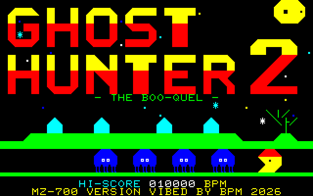
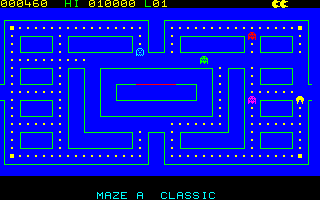
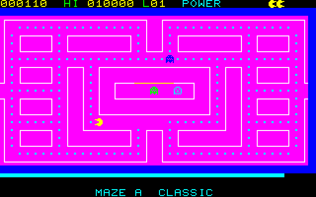
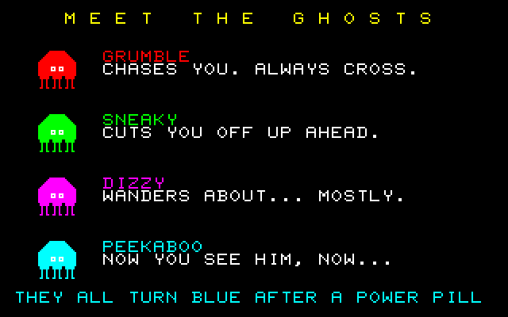

# GHOST HUNTER 2 — "The Boo-quel" (Sharp MZ-700)

A port of the VZ300 game *Ghost Hunter 2* (itself a sequel to *VZ Ghost
Hunter* by Dubois & McNamara) to the **Sharp MZ-700** (64K, PAL, stock
European character ROM, no PCG), loaded from tape or a UniCMT USB cassette
emulator. ViBED by BPM 2026.

 
 

`docs/title_music.wav` is the title music as recorded from the simulator's
sound chip.

## Running it

- **Real MZ-700 / UniCMT:** copy `release/GHOST2.MZF` to the USB stick and
  load it like a tape (`L` from the monitor). It loads at 1200h and starts
  by itself.
- **Emulator:** open `release/GHOST2.MZT` (the same file with the extension
  MZ700WIN expects).

## Controls

| Key | Action |
|---|---|
| Cursor keys or Q / A / O / P | move |
| SPACE or CR | start (title, attract pages) |
| CR | pause in game |
| S | sound on/off |
| 1 / 2 / 3 | on the title: game speed SLOW / NORMAL / FAST (NORMAL to start) |
| BREAK | give up |
| UP / DOWN, SPACE, CR | initials entry: change letter, next letter, done |

## What's in it

**Speed.** The VZ300 game moves 6.4 maze cells a second. Here each cell is two
characters and every move is a whole-character jump, so that pace felt far too
fast. Movement is scaled to 1/2, 5/8 or 3/4 of the VZ pace (SLOW, NORMAL, FAST),
and the bonus-round clocks stretch to match.

Everything from the VZ300 game, rebuilt for a character screen:

- **Six mazes** (Classic, Crossroads, Teleport Hall, Pillars, Plazas,
  Portal Run) with wrap-round tunnels, five wall styles and paired
  teleporters. Each VZ maze cell becomes a 2 x 2 block of characters, so
  the corridors are one character wide and the chomper and ghosts are the
  CG-ROM's own 8 x 8 game glyphs.
- **Four ghosts with their own minds:** GRUMBLE chases you (and gets
  enraged when few pellets are left), SNEAKY aims ahead of you, DIZZY
  wanders when he gets close, PEEKABOO flanks you and fades to just his eyes
  from level 2. Scatter/chase phases, reversals, tunnel slowdown, eyes
  going home.
- **Power-ups** under the ghost house: SPEED (with a trail), FREEZE,
  DECOY, DOUBLE, SHIELD, Halloween treasures, and HUNTER MODE after a
  perfect four-ghost chain. A label and timer bar show what's running.
- **Power mode:** the maze sweeps into a magenta/white palette while the
  ghosts are blue, the way the VZ swapped its colour set.
- **Round cycle:** A, B, intermission, C, GHOST BUFFET, D, intermission,
  E, F, PELLET PANIC, then round again faster.
- **Intermissions:** *Who's Hunting Who?* and *The Night Shift*, with big
  3 x 3-character sprites.
- Score pop-ups, chain bonuses, pellet streaks, particle bursts, hit-stop,
  a collapsing death, dancing ghosts at GAME OVER, extra life at 10,000.

**Attract mode:** title screen with music (big GHOST HUNTER logo with a
gleaming 2, moon, twinkling stars, graveyard, lightning and thunder, the
hero chased by four big ghosts and then chasing them back), Meet the
Ghosts, Power Up! with the controls, a **demo game** played by an AI pilot,
and the Hall of Fame. Any key leaves the demo.

**Sound:** one 8253 square-wave voice shared by a tracker-style music
player (lead, bass plucks, drums, arpeggios) and the effects, with the
in-game siren in the gaps. The tunes are the VZ300 ones.

## Technical notes

- The background (maze, pellets, HUD) lives in a buffer; each frame the
  game builds a list of overlay cells (actors, items, pop-ups, particles)
  and the renderer, at the start of VBLANK, restores last frame's overlay
  cells, copies changed background cells and draws the new list. Palette
  changes sweep three rows per frame. Runs at 50 frames a second.
- No ROM calls, no interrupts. Frame timing from the /VBLK bit (polarity
  measured at start-up).
- Memory: program 1200h-7BB1h, variables above it, background buffers at
  9000h/9800h, maze grid at A000h (codes), A600h (colour classes), AC00h
  (wall glyphs), stack at CFF0h.

## Building

Needs Python 3 (Pillow only for previews); sjasmplus is in `tools/`.

```
py build.py                        generate data, assemble, write build/ and release/
py tools/test_flow.py              scripted checks: power, items, death, clear, inter, bonus, over
py tools/test_demo.py 5000 500     watch the attract mode and the demo
py tools/test_speed.py             the 1/2/3 speed keys and the hero's speed at each setting
py tools/preview.py                render every maze to build/maze_X.png
py tools/mazes.py                  maze grids as text (also checks reachability and dead ends)
py tools/wav.py 40                 render the title music to build/title_music.wav
```

The simulator needs the MZ-700 character ROM as `rom/mz700fon.int` (not
included).

## Status

Tested in the Python MZ-700 simulator only; not yet on real hardware.
