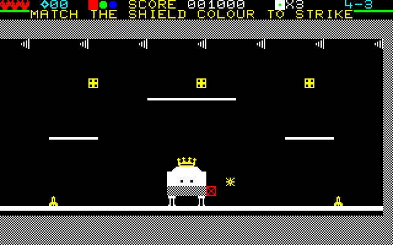

# KIKO AND THE COLOUR THIEF

An original mascot platformer for the **Sharp MZ-700** (64K, PAL, stock
European character ROM, no PCG). ViBED by BPM.

The Grey Baron has stolen the Prisms of Light. Kiko is a little chameleon who
can be any colour he likes. Over four worlds he wins back the colours, then
takes on the Baron in his grey castle.

  

`docs/title_music.wav` is the title theme, recorded from the simulator's model
of the 8253 sound chip.

## Running it

- **Real MZ-700 / UniCMT:** load `release/KIKO.MZF` like a tape. It loads at
  1200h and starts by itself.
- **Emulator:** open `release/KIKO.MZT` (the same file).

## Controls

| Key | Action |
|---|---|
| Cursor keys or O / P | run |
| SPACE / Z | jump (hold to jump higher) |
| X / M | tongue: eat enemies, grab gems |
| C / N | change colour (from World 2) |
| UP / DOWN | climb vines; DOWN on a plank drops through it |
| CR | pause |
| BREAK | quit to the title |

## The game

- **4 worlds, 12 levels, 40 flip-screen rooms:** Sunny Meadows, Ember
  Caverns, Clockwork Clouds and the Grey Castle. Each world ends with a boss:
  Big Bumble, Magma Mole, Prism Phantom and Baron Greyscale.
- **The colour mechanic:** chroma blocks are solid only while Kiko wears their
  colour, and appear as dotted ghosts otherwise. You can switch in mid-air to
  land on a block or to slip through a wall. Inkblot enemies can't see Kiko
  while he wears their colour. The last two bosses can only be hurt in a
  matching colour. Kiko owns green in World 1, gains red in World 2 and blue
  from World 3 on.
- Other features:
  - Stomping and tongue attacks.
  - 3 hearts per life, extra lives from smileys and from every 100 gems.
  - Apples restore a heart.
  - A hidden star in 8 of the levels.
  - Springs, vines, one-way planks, crumbling bridges, moving platforms, lifts
    and lava/goo pits.
  - Level-clear tally with an all-gems bonus.
- **Physics:** acceleration and skidding, variable jump height, coyote time
  (6 frames) and a jump buffer (7 frames), with 1/256-cell fixed-point motion
  at 50 Hz.
- **Front end:**
  - Rainbow-cycling title screen with a scroller and title music.
  - Story, how-to-play and high-score pages.
  - An AI-driven attract demo that plays level 1-1.
  - Prism screens between worlds, game over, ending with colour flood.
  - High-score name entry.

## Building

Needs Python 3 and Pillow. sjasmplus is in `tools/`. The simulator needs the
MZ-700 character ROM as `rom/mz700fon.int`.

```
py build.py                 generate data, assemble, write build/ and release/
py build.py preview         also draw every room and level map to build/rooms/
py tools/reach.py           solver: every level finishable, every pickup reachable
py tools/test_boss.py       beat all four bosses in the simulator
py tools/test_flow.py       final boss -> tally -> ending -> high-score entry
py tools/perf.py 0 1500     frame drops under the conservative VRAM wait model
py tools/run.py N shots --keys "f:key+key,..."   scripted run with screenshots
py tools/wav.py 40 out.wav  record the title music
```

| Path | What |
|---|---|
| `src/render.asm` | overlay compositing and dirty-cell flush |
| `src/room.asm` | room decoding, pickups, chroma blocks, animated tiles, crumble/spring timers |
| `src/hero.asm` | Kiko: physics, vines, tongue, colour swap, damage |
| `src/objects.asm` | enemies, platforms, shots, goal |
| `src/boss.asm` | the four bosses |
| `src/pilot.asm` | the demo AI |
| `src/game.asm` | level flow, HUD, pause |
| `src/screens.asm` | front end |
| `src/sound.asm` | one-voice tracker (from OVERRIDE) |
| `tools/levels.py` | all level maps (ASCII) |
| `tools/tiles.py`, `sprites.py`, `screens.py`, `music.py` | tiles, sprite cell art, pictures, songs |

## How it works

- **Graphics** are made only from the CG-ROM's 512 glyphs, each with its own
  foreground and background colour. Sprites are composed by hand from glyphs
  and are recoloured through 256-byte attribute tables. That is how Kiko
  changes colour, and how hits flash white.
  - I tried an automatic "best glyph" converter for smooth sub-cell sprites.
    It produced mush, so sprites move in whole cells (8 px). The fixed-point
    physics and per-step run animation keep motion smooth in time.
- **Rendering:** each cell's overlay, shadow, attribute and VRAM addresses
  differ only in the high byte. Every frame, the cells sprites covered last
  frame are restored from the tile map and the sprites are drawn into the
  overlay. At VBLANK only the cells that differ from the shadow are written
  to VRAM. No flicker and no full redraws: under the conservative VRAM wait
  model (every access held to the 63-T line window), levels 1-1, 2-2 and the
  final boss each dropped only 1 frame (the room load) in 600–1500 frames.
- **Rooms** are tile-id maps (RLE). Python does the auto-tiling and stamps
  (clouds, trees). Each room averages ~180 bytes; the whole game binary is
  about 33 KB.

## Testing status

- Everything here was tested **only in the Python Z80/MZ-700 simulator**
  (`tools/mzsim.py`). It has **not** been run on real hardware or in a
  third-party emulator yet.
- What was tested in the simulator:
  - The attract loop and the demo pilot finishing 1-1.
  - All four bosses beaten (test harness).
  - Ending, high-score entry, room transitions and frame timing.
- `tools/reach.py` passes all 12 levels. It uses its own copy of the physics,
  ignores enemies, and treats moving platforms optimistically.
- What still needs doing:
  - Real hardware / emulator check, especially the real VBLANK polarity (it
    is measured at boot) and how the sound sounds.
  - Hand play-testing of difficulty, particularly the colour-switch jumps in
    Worlds 2–4 and the inkblots.
  - Further art polish (W3 ground texture, small-enemy sprites) is possible.
- There is no joystick support: the stock MZ-700 has none.
