# SHARP EDGES

*A 22-part megademo for the Sharp MZ-700, in one load.*
ViBED by BPM 2026.

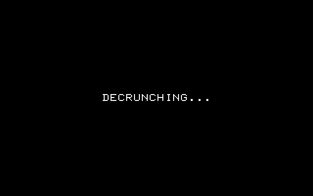

**No sprites. No scrolling. No mercy.** The Sharp MZ-700 has 40 x 25 text,
eight colours, a character set fixed in ROM and one square-wave beeper.
SHARP EDGES is a 1990s party megademo made for it anyway. It runs for five
minutes in twenty-two parts, cut to its own soundtrack, and loads in one go.
Then it starts over.

**It opens the way the party releases did:** "DECRUNCHING..." on a black
screen, a typewriter intro from the (made-up) group SPRITELESS, then a
colour glitch and the title. The SHARP EDGES logo is built from the
character ROM's diagonal half-cells, with copper bars sliding behind it a
scan line at a time. As it appears, the machine shouts its name: a real
sampled voice, out of a speaker that was only meant to beep.

**After that come the classics, one after another.** Plasma, a 3D
starfield, a rotozoomer, fire, a tunnel and a vortex. Kefrens bars, a
twister, shadebobs and moiré rings. A synthwave sunset over a checkerboard
floor, a solid vector cube and morphing vector dots. Rolling barrel
scrollers, sine dots, endless bobs and a wobbling logo. Then the machine
appears to crash, and the greetings scroll past with a rippling reflection.

| | |
|---|---|
| 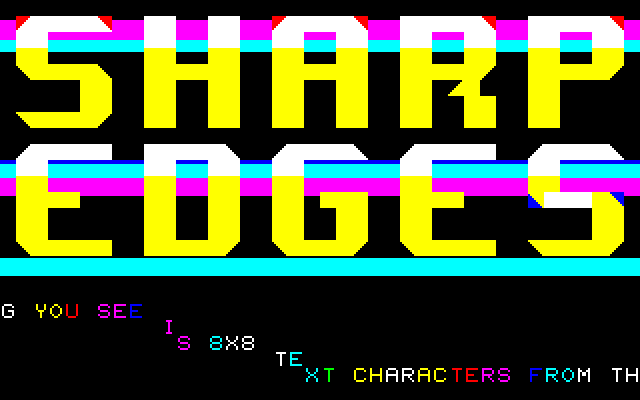 | 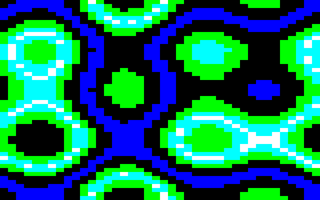 |
| 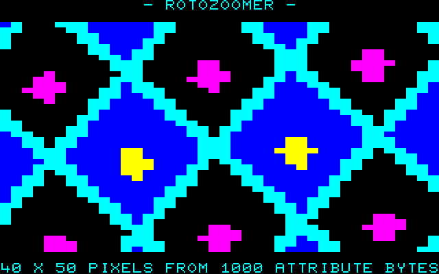 | 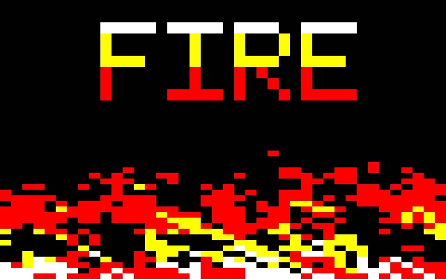 |
| 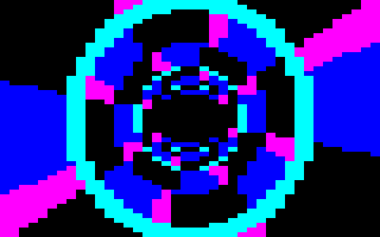 | 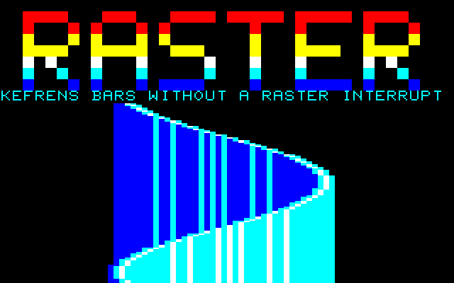 |
| 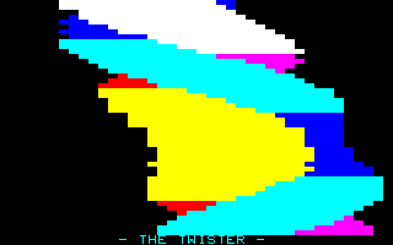 | 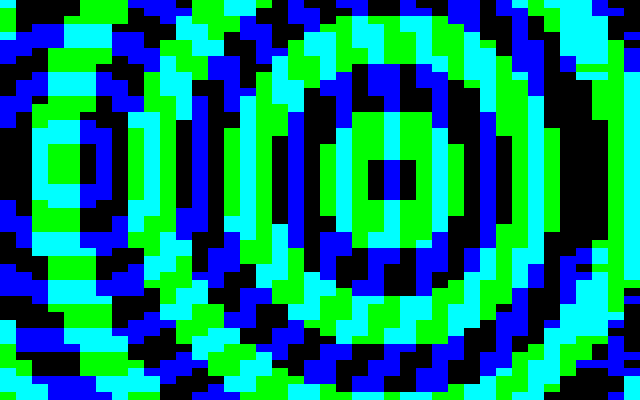 |
| 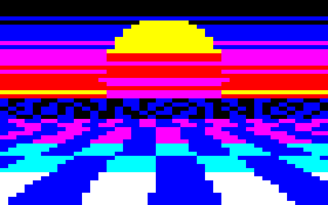 | 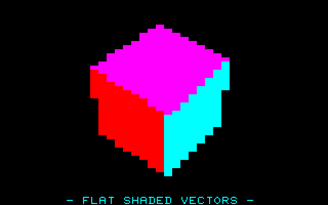 |
| 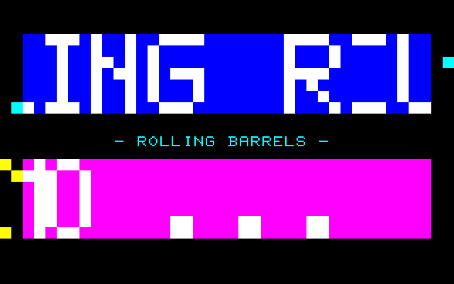 | 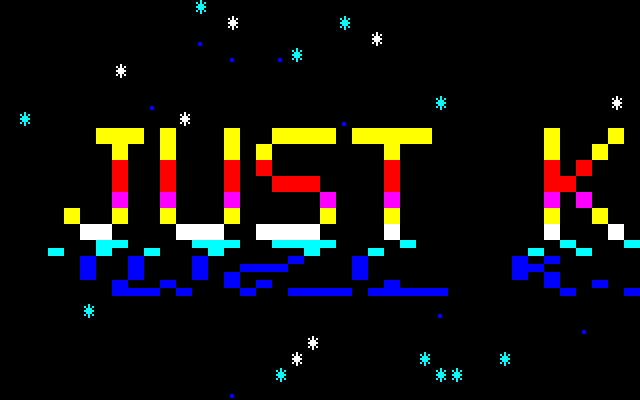 |

## The running order

| # | Part | |
|---|---|---|
| 1 | Intro | typewriter text, then a glitch into the title |
| 2 | Title | the logo, copper bars behind it, a sine scroller, and "Sharp edges!" spoken |
| 3 | Plasma | 40 x 50 colour pixels, a new palette every bar |
| 4 | 3D starfield | stars rushing past at warp speed |
| 5 | Rotozoomer | a tiled pattern spinning and zooming |
| 6 | Fire | flames licking up under a big FIRE |
| 7 | Tunnel | flying down a textured, turning tunnel |
| 8 | Vortex | the same tunnel, twisted into a spiral |
| 9 | Kefrens bars | a bar on every scan line, stacking into a curtain |
| 10 | Twister | a square bar twisting and swaying |
| 11 | Shadebobs | glowing trails that cycle through the colours |
| 12 | Moiré | two sets of rings interfering |
| 13 | Sunset floor | a striped sun over a checkerboard rushing towards you |
| 14 | Vector cube | a solid, shaded cube turning in 3D |
| 15 | Vector dots | 64 dots morphing: sphere, cube, torus, double helix, "MZ", star |
| 16 | Rolling barrels | two text cylinders turning opposite ways |
| 17 | Sine dots | dots on curves that change shape every bar |
| 18 | Endless bobs | balls that are never erased, until the screen is full |
| 19 | Wobbling logo | the logo waving, a pixel row at a time |
| 20 | Fake crash | garbage, noise and a meditation box... |
| 21 | Greetings | "JUST KIDDING!", then the greetings with a rippling reflection |
| 22 | The end | the credits under a colour wave |

| | |
|---|---|
| 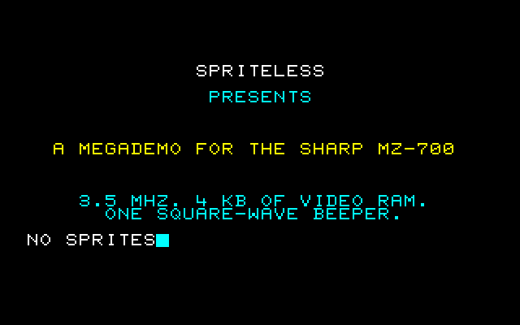 | 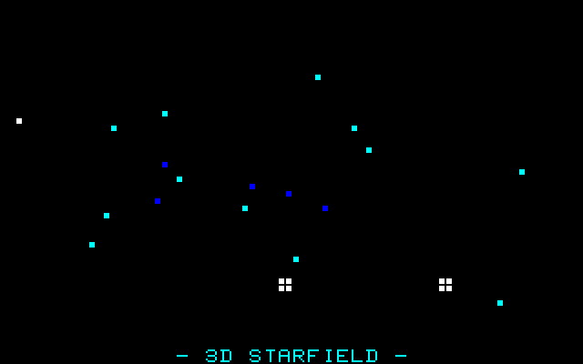 |
| 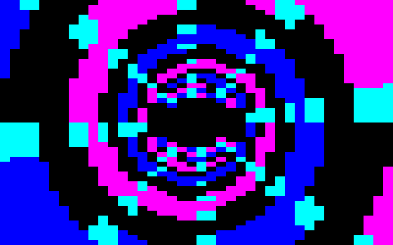 | 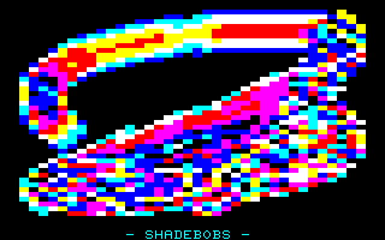 |
| 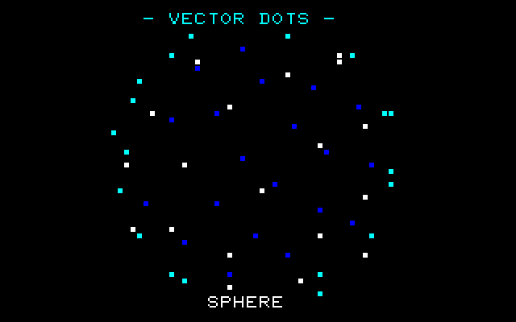 | 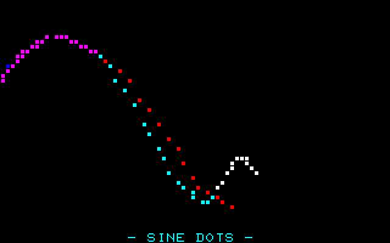 |
| 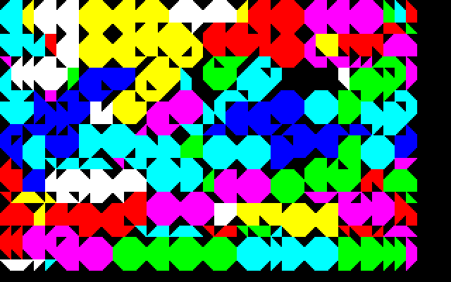 | 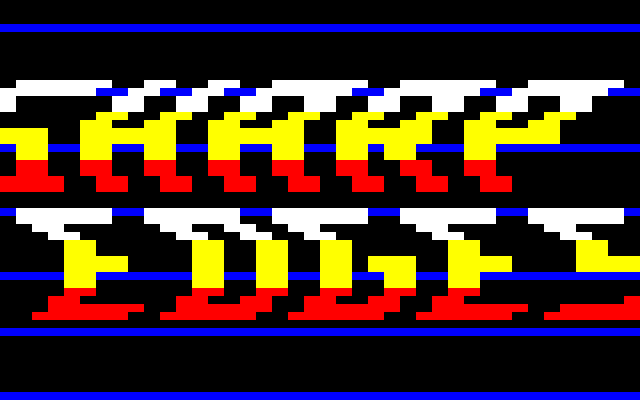 |
| 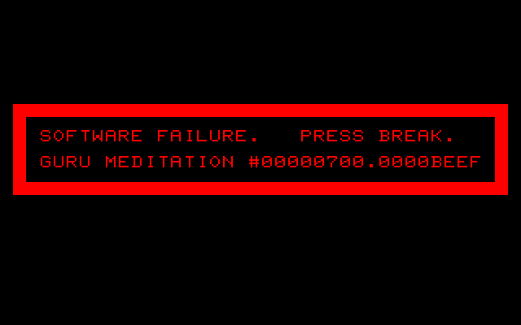 | 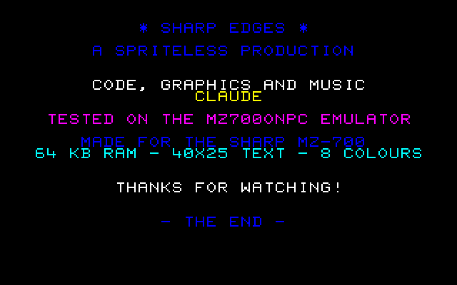 |

## What's inside

- **Twenty-two parts and a five-minute soundtrack** of 158 bars, with
  every part change landing on the beat with a white flash.
- **More colours than the machine has pixels for.** Most effects run in a
  "half-block" mode: every character is the ROM's top-half block, so each
  cell shows two colour pixels, one above the other. That gives a 40 x 50
  picture in eight colours, changed by writing nothing but colour bytes.
- **Kefrens bars without a raster interrupt.** The MZ-700 makes the Z80
  wait whenever it touches video memory while the picture is being drawn,
  until that line's short free window. So a loop that writes once per pass
  writes exactly once per scan line, and the bars land on 128 separate lines.
- **Sampled speech from a beeper.** "Sharp edges!" is played by switching
  the timer chip between two modes 15,600 times a second.
- **Music that never misses a beat.** It plays from the timer chip's
  interrupt 100 times a second, while the effects take the whole CPU. Lead,
  bass and chord arpeggios share the one square-wave channel by taking turns
  a hundredth of a second at a time, with noise-burst drums.
- **The whole demo in one load**, with the parts' tables built when each
  part starts and the 12 KB of RAM hidden under video memory filled with
  data.
- Tested in the MZ700onPC emulator; not yet run on a real machine.

## Technical specifications

| | |
|---|---|
| Machine | Sharp MZ-700, stock: Z80A at 3.5 MHz, 64 KB RAM, PAL |
| Display | 40 x 25 text, 8 colours, built-in European character ROM only (no PCG, no bitmap mode) |
| Chunky modes | 40 x 50 in 8 colours (top-half block 7Ah: two colour pixels per cell, attributes only); 80 x 50 dots (the ROM's dotted quarter blocks F0h-FFh); 52 x 25 colour columns for the Kefrens bars (left-half block 7Bh) |
| Blits | Unrolled `pop hl / ld (nn),hl` per 40-byte row, about 6 bytes per scan line under the video-memory wait states (1,000 bytes in about 170 lines). Several parts write only the cells that change, straight into video memory |
| Raster timing | Kefrens: each video-memory access waits for its line's free window (T-states 128-208 of a 227-T-state line), so a loop of 119 T-states writes once per line. Line 72 is found from the 8253's scan-line counter, which reads the same at the start of every frame (312 = 4 x 78 lines) |
| Frame rates | 50 fps: shadebobs, endless bobs, crash, Kefrens display. 25 fps: title, starfield, tunnel, vortex, twister, barrels, greetings. 16-23 fps: plasma, rotozoomer, fire, moiré, floor, cube, dots, sine dots, wobble |
| Sound | 8253 counter 0 as a square wave, set from the counter-1/counter-2 interrupt at 100 Hz (counter 1 counts 78 scan lines, counter 2 counts 2 of those). One byte per tick: a note, silence or a noise burst; lead and bass interleaved tick by tick |
| Speech | 0.93 s of Windows text-to-speech, resampled to 15.6 kHz and reduced to 1 bit by sigma-delta modulation (1,815 bytes); each bit is an 8253 control word, mode 0 (low) or mode 4 (high) |
| Memory | The monitor ROM is switched out so the interrupt handler sits at 0038h. Each part builds its tables in an 8 KB work area when it starts; data that can't be generated lives in the RAM under video memory and is copied down 256 bytes at a time |
| Compression | Two LZ streams (program and high-RAM data), unpacked by a stub that shows "DECRUNCHING..." |
| Media | `SHARPEDG.MZF` for a real machine through a UniCMT or tape; `SHARPEDG.MZT` for emulators (identical) |
| File | 31,783 bytes (plus the 128-byte tape header), loads at 1200h and starts by itself. It unpacks to 39,160 bytes of program and 8,167 bytes of high-RAM data |
| Language | Z80 assembly (sjasmplus), about 5,600 lines; the music, tables, textures, logo, speech and packer in Python |

### RAM used

| Area | Address | Bytes |
|---|---|---|
| Interrupt vector | 0000h-00FFh | 256 |
| Rotation tables (dots, cube); Kefrens line state | 0100h-031Fh | 544 |
| Attribute and character back buffers; Kefrens lists and row states | 0400h-0BFFh | 2,048 |
| Interrupt stack, stack | 0C00h-0FFFh | 1,024 |
| Kefrens row states (second set) | 1000h-119Fh | 416 |
| Program, music, text, small tables | 1200h-AAF7h | 39,160 |
| Work area: each part's tables and textures | B000h-CFFFh | 8,192 |
| High RAM: tunnel map, dot shapes, moiré rings, sky, twister spans, speech | D000h-EFE6h | 8,167 |
| **Total** | | **59,807 (58.4 KB)** |

That leaves 5,729 bytes of the 64 KB free: 0320h-03FFh, 11A0h-11FFh,
AAF8h-AFFFh and EFE7h-FFFFh. Video and colour RAM (D000h-DFFFh as seen
with the RAM banked out) and the monitor ROM are not counted.
