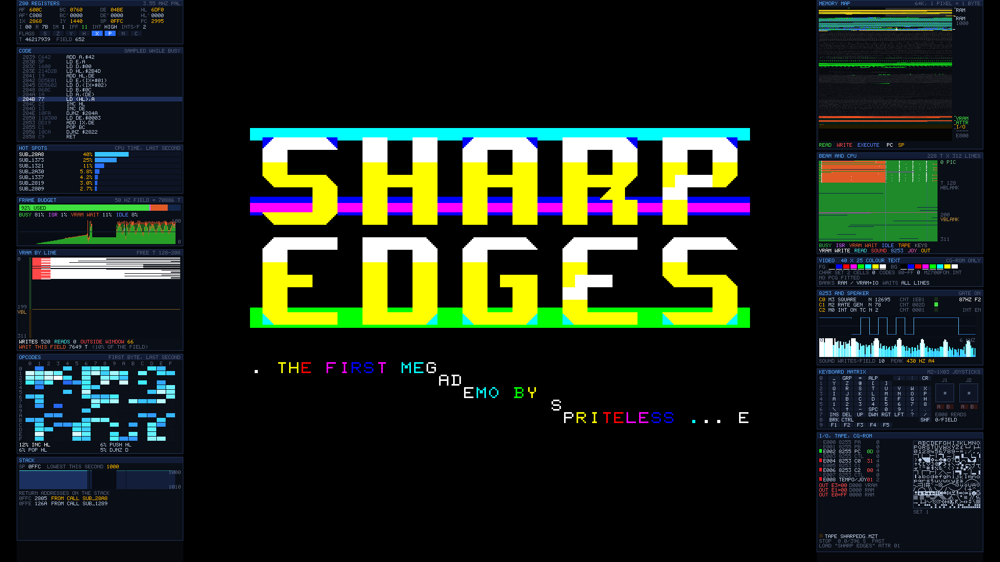
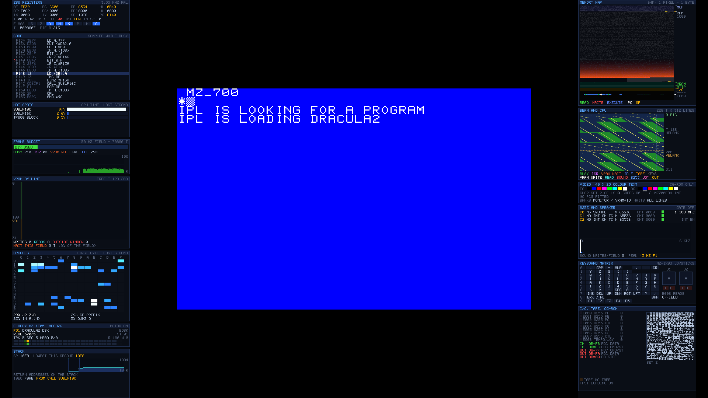
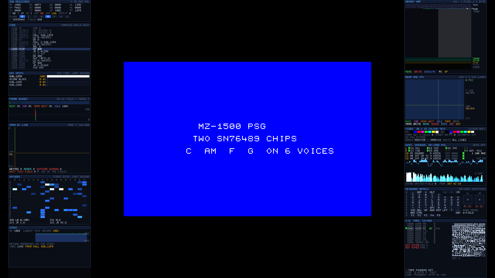
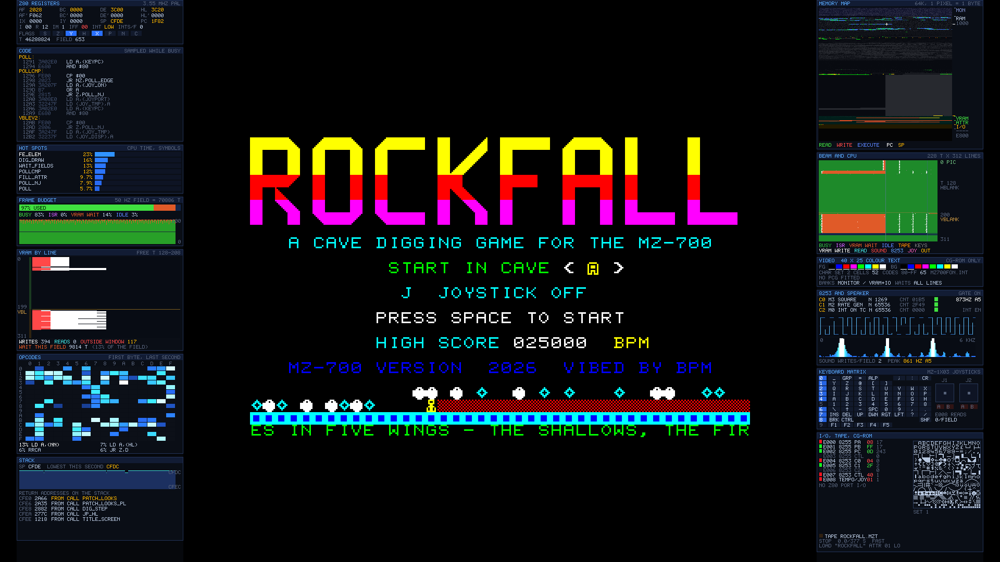
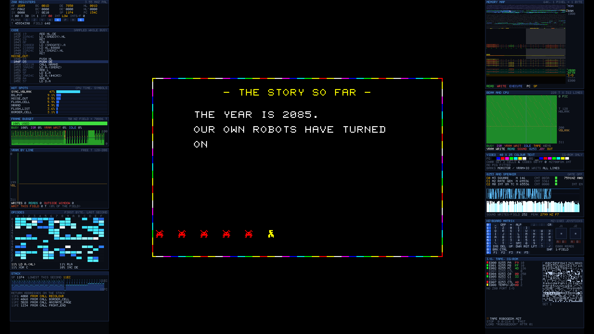
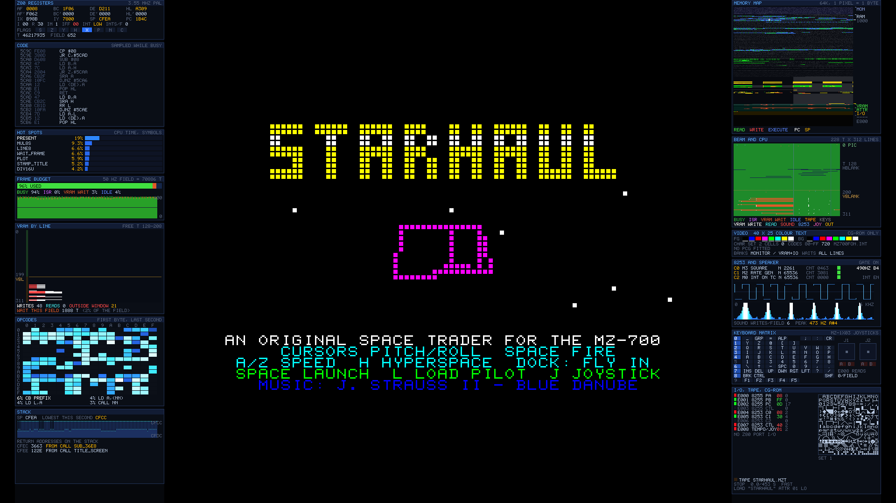
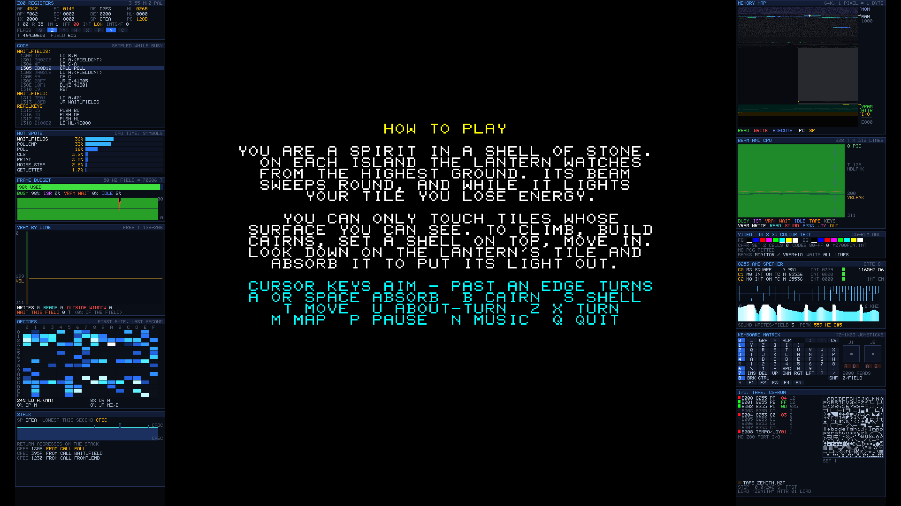
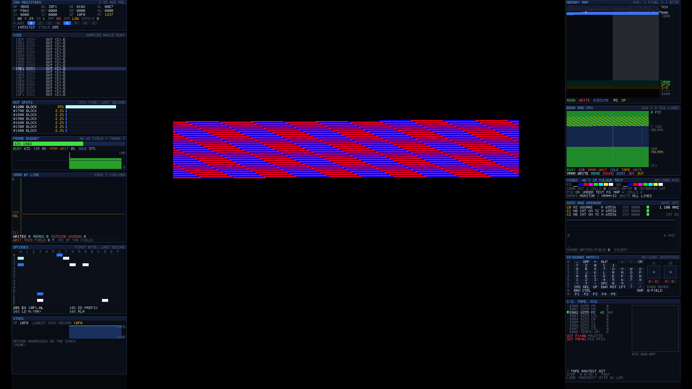

# MZ700onPC

*A Sharp MZ-700 emulator for Windows, with a full-screen visualiser and a headless test runner.*
ViBED by BPM 2026.

**See what the MZ-700 is really doing.** MZ700onPC runs MZ-700 games and demos at the real machine's speed,
down to the VRAM wait states that make or break a fast renderer. Press F10 and the screen is flanked by two
columns of live instruments. One column shows what the CPU is executing, where its time goes and what the stack
holds. The other shows the memory, the beam, the video and sound chips, the keyboard, the joysticks and the tape
or disk drive. Watch a field being drawn line by line and see each VRAM access land inside or outside the
blanking window. You can also see where the speaker's note is coming from, or which track the floppy head is
reading.

It was built to test the MZ-700 games in this collection, and every one of them has been through it. It is
also a good way to explore the classic demos and see how they pull their tricks.

| | |
|---|---|
|  |  |
|  |  |
|  |  |
|  | |

## The visualiser

**Left column: the CPU**
- **Z80 registers and flags,** with changes lit in amber.
- **Live code,** disassembled round a sampled busy PC, with your symbol names. Symbols from sjasmplus or zasm are
  picked up automatically.
- **Hot spots:** CPU time per routine over the last second.
- **Frame budget:** each 50 Hz field split into busy, interrupt, VRAM wait, tape and idle time, with a six-second
  history.
- **Beam, line by line:** every picture line at one column per T-state, with the picture as drawn. Each VRAM,
  PCG and palette write sits at the exact T-state it happened, beside the pixel it changed. Also shown: the
  HBLANK free window, and per-line VRAM counts with accesses outside the window in red.
- **Opcodes:** a heat map of the instructions the program actually uses.
- **Floppy:** the controller's command and status, the head position, sectors read and written, and a track map
  that flashes as the disk is read and written.
- **Stack:** SP over time and the return addresses, named.

**Right column: the machine**
- **Memory map:** all 64K, with reads, writes and execution glowing and the current bank switching labelled.
- **Beam and CPU:** one whole field as 228 T × 312 lines, showing what the CPU did at every moment of the TV
  picture. Overlays show VRAM accesses, sound writes, joystick reads and port OUTs.
- **Video:** the colours in use, the character sets, the PCG state, the banks and the wait mode.
- **Sound:** the 8253's three counters, the speaker's note, a scope and a spectrum. With the MZ-1500 PSG fitted,
  every voice of both chips is shown with its note and volume.
- **Keyboard and joysticks:** the 10 × 8 matrix, with the rows the game scans flashing, and both MZ-1X03 sticks.
- **I/O, tape and character generator:** register and port activity by name, the data recorder, and the whole
  CG-ROM or PCG as a glyph grid.

## Tech specs

**The machine**
- Sharp MZ-700, European PAL model. Z80 at 3.546895 MHz, from a 17.734475 MHz master clock.
- 64K RAM, with the full bank switching of `OUT E0`–`E6`, including the `E5`/`E6` lock.
- Runs the real 1Z-013A monitor when you supply it. Without it, a built-in stand-in runs machine-code programs.

**Pixel-exact, timed to the T-state**
- The picture is drawn as the beam goes, 0.4 T a pixel. Every memory and I/O access is timed to its own Z80
  machine cycle, so a colour or character change made part-way along a line appears at the exact pixel the beam
  had reached. Raster splits, mid-line palette tricks and HBLANK-timed code are drawn where the beam really was.
- Lines are 227.2 T and a field is 312 lines (70886.4 T, 50 Hz). The picture is the first 128 T of lines
  0–199.
- **VRAM wait states.** Outside each line's blanking window the CPU is held in WAIT. There are four models:
  accurate (T 128–208 free, as in Takeda's eMZ-700), conservative (T 128–191, as measured on NTSC hardware),
  picture lines only, or off.
- Monitor ROM accesses take one wait state. The /VBLK, HBLANK, TEMPO and cursor-blink signals are all on time.
- **Checked on a real PAL MZ-700.** Two test programs measure the CPU clock, the field, the VRAM wait window, and
  HBLANK and VBLANK down to the T-state. On the real machine they give the same numbers as the emulator. They
  are included in `test\`, so you can run them on your own machine.

**Video**
- 40 × 25 colour text from the CG-ROM, drawn line by line as the beam goes. European or Japanese character ROM.
- **HAL PCG-700** (optional): user-defined characters 80–FF in both sets.
- **MZ-1500 colour PCG** (optional): three planes, 1024 characters, priority and palette.

**Sound**
- The 8253 drives the speaker, integrated exactly at 44.1 kHz, so pulse-width and control-word mixers sound
  right.
- **MZ-1500 PSG** (optional): two SN76489AN chips on `OUT E9`/`F2`/`F3`, three tones and a noise channel each,
  mixed with the speaker.

**Input**
- The full MZ-700 keyboard, including F1–F5. All of the emulator's own keys are on F6–F12, which the MZ doesn't
  have.
- Two **MZ-1X03** analogue joysticks. PC gamepads and their analogue sticks drive them. Alternatively, a gamepad
  can play keyboard games through the cursor keys, SPACE and RETURN.

**Storage**
- **Data recorder.** MZT/MZF tapes load instantly, or at real speed through the monitor's own loader as a true
  Sharp PWM signal. WAV, FLAC and MP3 recordings of real tapes play too. `SAVE` records back to `.MZT` or
  `.WAV`.
- **Floppy disks** (optional): the MZ-1E05 interface and MZ-1F02 drives. This is an MB8876 controller with the
  real disk timing: 300 rpm, 32 µs a byte, lost data if a program can't keep up.
  - D88, DSK, Extended DSK and raw 2D images, with changes saved back.
  - Type `F` at the monitor to boot, as on the real machine. A built-in boot ROM is used when Sharp's isn't
    supplied.
  - Turn any tape game into a bootable disk from the Disk menu.

**For developers: mzemu.exe**
- The same emulator with no window, running at about 40× real time from a script or the command line.
- Load and run a program, type keys, move the joysticks, wait for text on screen, then take screenshots or dump
  memory.
- Record WAVs and sound-register logs, profile T-states per routine, count VRAM waits and catch crashes.
- Insert, boot, build and dump disks, and save the visualiser itself as a PNG.

## Getting started

1. Unzip `MZ700onPC` anywhere. There is nothing to install.
2. Put your own copies of the Sharp ROMs in `roms\`: `1z013a.rom` and `mz700fon.int`. They are not included.
3. Run `MZ700onPC.exe`, then drop an `.MZT` game or a `.DSK` disk on the window. Press **F10** for the
   visualiser and **F11** for full screen.

Windows 7 or later, with the .NET Framework 4 that Windows already has.
