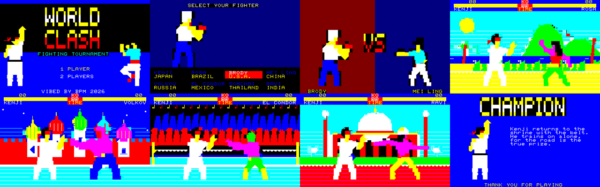
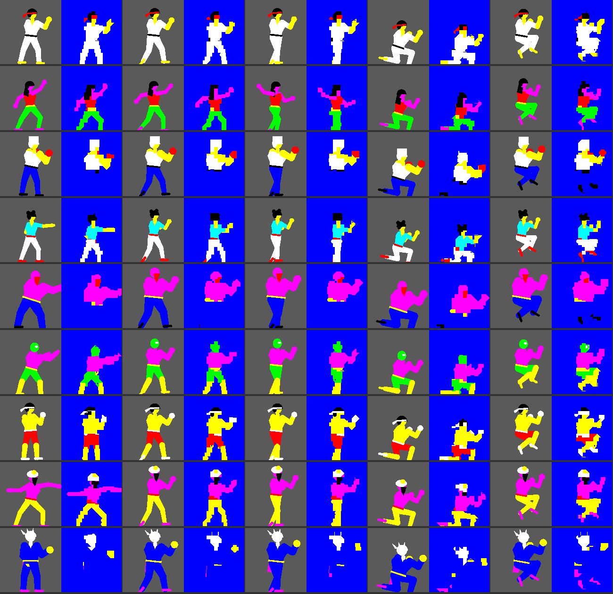

# WORLD CLASH — the fighting tournament

A one-on-one, Street Fighter II-style fighting game for the Sharp MZ-700
(64K, PAL, European CG-ROM, **no PCG**). Eight original world warriors and a
boss, nine animated national stages, specials on motion inputs, a CPU
opponent, a two-player mode, and the full arcade front end: title, attract
demo, roster, select, VS, continue, endings and high scores.



- `release/WORLDCLASH.MZT` for emulators (MZ700onPC), `release/WORLDCLASH.MZF`
  (identical bytes) for a real euro-spec MZ-700 via UniCMT. It loads at
  1200h and decrunches itself (46 KB on tape).
- **Tested only in MZ700onPC** so far, not on a real machine.

## Controls

| | 1 player | 2 players: P1 | 2 players: P2 |
|---|---|---|---|
| Move / jump / crouch | cursor keys (or W A S D) | W A S D | cursor keys |
| Punch | Z (or SPACE) | V | K |
| Kick | X (or G) | G | L |

**Joysticks (Sharp MZ-1X03):** press **J** on the title to cycle *JOYSTICK
OFF* → *1P* (stick A for player 1) → *1P + 2P* (sticks A and B). Button 1
punches, button 2 kicks; the stick also drives the menus (up/down choose,
a button starts). Centre the sticks before pressing J: the centre is learnt
then (an empty socket learns nothing and is ignored). It is off by default
because timing the stick pulses means waiting for VBLANK: with it on, a demo
fight runs at about 23 fps instead of about 24.6. The continue and
high-score screens still need the keyboard.

Hold **back** to block (crouch-block for sweeps; jump attacks must be blocked
standing). Close + toward + punch throws. BREAK pauses; BREAK twice quits to
the title.

Specials (written for a fighter facing right):

| Motion | Move |
|---|---|
| ↓ ↘ → + punch | special A: projectile (Kenji, Mei Ling, Somchai, Ravi, Zarkon) or rush (Brody, Volkov) |
| punch ×3 quickly | flurry (Rosa, El Condor) |
| → ↓ ↘ + punch | rising uppercut (Kenji, Brody, Volkov, Somchai), invincible at the start |
| ↓ ↙ ← + kick | spin kick (Rosa, Mei Ling, Ravi), flying dive (El Condor), rush (Zarkon) |

## The roster

| Fighter | Country | Style | Stage |
|---|---|---|---|
| Kenji | Japan | karate | shrine at sunset, falling petals |
| Rosa | Brazil | capoeira | Rio beach, waves, cable car, bobbing crowd |
| Brody | U.S.A. | street boxer | New York rooftop, neon sign, lit windows |
| Mei Ling | China | kung fu | night market, swinging lanterns |
| Volkov | Russia | sambo wrestler | onion domes in the snow |
| El Condor | Mexico | luchador | lucha arena, cheering stands, flashing lights |
| Somchai | Thailand | muay thai | golden temple, river, passing boat |
| Ravi | India | kalaripayattu | red-sandstone palace, fountains, peacock |
| Zarkon (boss) | ? | — | storm fortress, lightning, lava |



## How it works

- **Fighters** are drawn procedurally in Python (`tools/figure.py`): a
  skeleton in a pose (joint angles) dressed with a build (proportions) and a
  costume (colours, hair style, beard, mask, cape, wraps), rendered at
  4× supersampling and matched cell by cell to ROM glyphs (`tools/cells.py`).
  Each 8×8 cell is either two of the fighter's colours, or one colour on a
  transparent background (attr bit 3), which takes the paper colour of the
  stage cell underneath at run time.
- Only the 63 shape glyphs whose **left-right mirror image is also in the
  ROM** are used, so every frame can face either way exactly: the engine keeps
  a mirrored-char page per fighter and draws runs backwards.
- 18 poses per fighter (2–2.5 KB each) as runs of indices into a per-fighter
  cell dictionary of up to 255 (char, attr) pairs. The frames fill the RAM
  behind VRAM (D000–FFFF, 12 KB) and spill into the program.
- **Compositor** (`src/render.asm`, `render2.asm`): the stage lives in a BG
  buffer; each object's previous ∪ current box is copied BG → COMP, the
  sprites are drawn into COMP, and only the cells that differ from SHOWN go
  to VRAM. COMP and SHOWN are interleaved in one 4 KB block (C000/C400,
  attrs C800/CC00) so SHOWN = `set 2,h` and VRAM = `set 4,h`. Stage
  animation goes through the same path. 25 fps (≈91% of frames on time in a
  demo fight).
- Palette tricks via a 256-byte attribute translation page per player: the
  white hit flash, and alternate colours for a mirror match.
- **Stages** are 320×176 pictures drawn in Python (`tools/stages_art.py`) and
  matched to glyphs, with animated layers stored as per-phase cell deltas;
  picture + animation are crunch-packed together (≈1 KB a stage) and the
  animation unpacks into spare bytes of the BG buffer.
- **Readability rules for the art**: a sprite's edge cells take the paper
  colour of the stage cell beneath, so the zone behind the fighters uses big
  flat shapes, crowds are one-colour silhouettes, floors are striped, and no
  stage's main colours match a fighter's large costume areas (Rosa wears red
  and green on the yellow beach, Volkov blue trunks against the red Kremlin
  wall, the India palace is red sandstone, not white). Menu backdrops are
  checker textures, since every flat colour hides somebody.
- **Sound**: the 100 Hz interrupt tracker from WARDSTONE (lead, chords,
  arpeggios, kick/snare/hat) with a theme per country, title, select, boss,
  win, lose and ending tunes, and 21 effects.
- **Joysticks** (`src/joy.asm`): every other frame the frame ends at a
  VBLANK edge, all four axis pulses on E008h are timed in one loop, and the
  frame clock restarts there (the 100 Hz interrupt is locked to the scan
  lines, two ticks a field). Buttons are read during the picture every frame.
- **AI** (`src/ai.asm`) presses the same virtual inputs as a player,
  including the motion sequences for specials; level rises through the
  ladder.
- Banners ("ROUND 1", "FIGHT!", "K.O.", "PERFECT") and the logo are drawn at
  run time from a 5×5 block font, each font pixel half a cell wide.

## Building and testing

```
py build.py            # release/WORLDCLASH.MZT + .MZF (and build/)
py build.py debug
py tools/jrfix.py      # build, turning out-of-range JRs into JPs
py tools/sheet.py kenji             # a fighter's frames, pixels vs cells
py tools/stageprev.py               # all stages as cells
../MZ700onPC/mzemu.exe -e "mzt release/WORLDCLASH.MZT; frames 1500; screen s.png 2"
```

Memory: program 1200–A52E (limit AFFF), high RAM D000–FEDD. About 2.7 KB of
program space is left.

## Not done yet

- The joystick code has only been tried in MZ700onPC (whose MZ-1X03 pulse
  model differs from Sharp's documented 270 + 28 × position T; the learnt
  centre copes with both, but a real stick hasn't been tried).
- Real-hardware test of speed, sound balance and the decrunch time.
- Balance: the CPU at the top levels has only been watched in the emulator.
