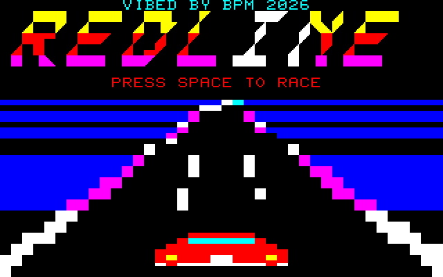
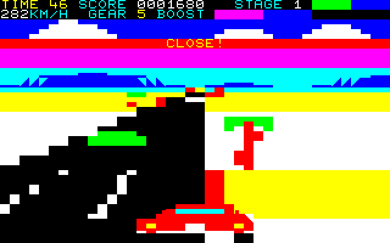
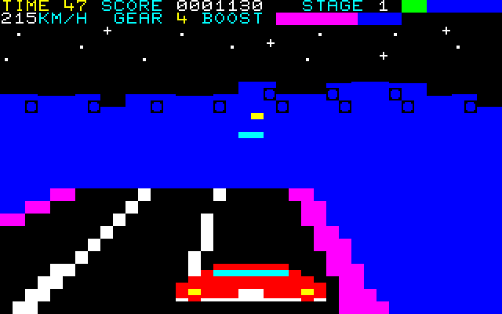
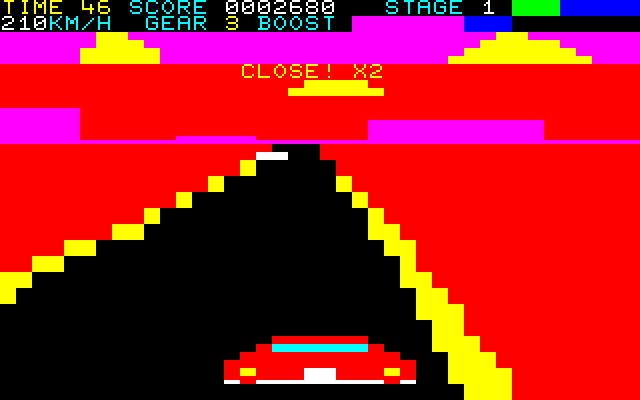
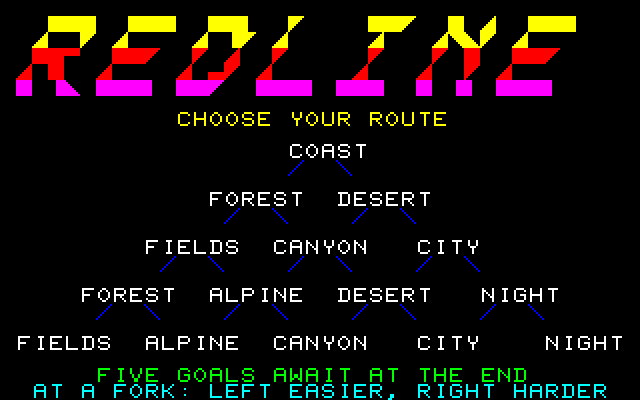
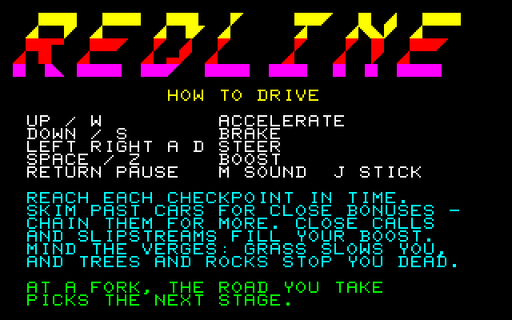

# REDLINE (MZ-700)

A pseudo-3D road racer for the **Sharp MZ-700** (64K, PAL, stock European
character ROM, no PCG), loaded from tape or a UniCMT USB cassette emulator.
It is an original game: original code, graphics, courses and music.
ViBED by BPM 2026.

 
 
 

## Play it

- **Real MZ-700 / UniCMT:** copy `release/REDLINE.MZT` to the USB stick
  (`release/REDLINE.MZF` is the same file under the other common extension)
  and load it like a tape (`L` from the monitor). It loads at 1200h and
  starts by itself.
- **MZ700onPC / MZ700WIN:** open `release/REDLINE.MZT`.

## Controls

| Key | |
|---|---|
| **Cursor up** or **W** | accelerate |
| **Cursor down** or **S** | brake |
| **Cursor left/right** or **A / D** | steer |
| **SPACE**, **Z** or **K** | boost (while the BOOST bar lasts) |
| RETURN | pause (Q quits to the title while paused) |
| M | sound: ENGINE + FX → MUSIC + FX → FX ONLY → OFF |
| J (title pages) | MZ-1X03 joystick in port A on/off: stick up accelerates, button 1 boosts |
| A-Z, DEL, RETURN | type your initials for the high-score table |

## The game

Race the clock across five stages. Every course ends at a **fork**: a
banner names both destinations, the road splits in two, and the road you
are on when they part picks the next stage - **left is the easier course,
right the harder one**. Fifteen courses in a pyramid lead to five
different goals.

| | Courses |
|---|---|
| Stage 1 | Sunset Coast |
| Stage 2 | Pine Forest, Desert Run |
| Stage 3 | Windmill Fields, Red Canyon, Neon City |
| Stage 4 | Pine Forest, Alpine Pass, Desert Run, Midnight Highway |
| Stage 5 | Windmill Fields, Alpine Pass, Red Canyon, Neon City, Midnight Highway |

- **Time:** 65 seconds to start, 45 more at every checkpoint. Run out and
  the car rolls to a stop.
- **Traffic:** cars and trucks in three lanes, some of them changing lanes.
  Running into one costs you most of your speed.
- **Close calls:** skim past a car at speed for 500 points and a chunk of
  boost. Chain them (CLOSE! X2, X3 ...) for more: the combo runs out after
  three seconds without one.
- **Slipstream:** sit right behind a car to fill the boost bar.
- **Verges:** the grass slows you down; palms, pines, cacti, rocks, lamps and
  signs stop you dead and spin you round.
- **Bends** pull you towards the outside, harder the faster you go; hills
  slow you on the way up. Yellow arrow signs warn of the sharp bends.
- **Score:** distance, close calls, and 10,000 points for every second left
  at the goal.

## Attract sequence

The title runs over a live race (the computer drives a random course),
then the route map (your last route is highlighted), how to drive, the
high scores and a demo race with the full HUD. SPACE starts a race from
any of them.

## How it works

- **The road picture** is character rows 9-24, every cell the upper-half
  block (7Ah): the cell's foreground colour is its top half and the
  background its bottom half, so the road is a 40 x 32 colour picture held
  entirely in the attributes.
- **Projection:** the segments ahead (every one near the camera, then every
  2nd, 4th and 8th) are projected with curve accumulation and hills; between
  two samples the strip's sub-rows are filled with interpolated centre and
  width, nearest first, so a crest hides the road behind it. Each character
  row is one pass of runs (grass, rumble, road, lane lines ...) whose edges
  come from lookup tables; the colour pair for each run comes from a table
  of top/bottom stripe combinations.
- **Forks** are the same rows with a second road (and a grass median); after
  the choice the road not taken drifts off to the side.
- **Sprites** (roadside objects, traffic) are chunky pictures in half cells,
  pre-scaled to 10 sizes at build time and drawn far to near, clipped by the
  road in front of them. The player's car is ROM characters, converted from
  a pixel picture by `tools/art.py`.
- **The copy to the screen** pops the 640-byte attribute picture off the
  stack and pushes it into colour RAM, 12 bytes per scan line's VRAM window
  (half the time of LDI).
- **Timing:** 16.7 frames a second most of the time (25 on easy stretches);
  the world steps once per PAL field, so the speed of play doesn't depend on
  the drawing rate.
- **Sound** is the 8253's square wave: an engine note that climbs through
  five gears, effects, and an original tracker tune on the title (and, if
  you choose MUSIC, in the race).
- At start-up the monitor ROM is paged out and the road's lookup tables are
  built in the 4K of RAM under it.

## Building

```
py tools/build.py
```

needs Python 3 with Pillow (for the preview tools only) and `sjasmplus` in
`tools/sjasmplus/` (not kept in the repository). The European character ROM
goes in `rom/mz700fon.int` (not kept either; only `tools/art.py`'s glyph
conversion reads it).

- `tools/gen.py` - sprites (`tools/art.py`), the car and the logo, the
  stack blit, size steps
- `tools/track.py` - courses, themes, skylines, the route
- `tools/music.py` - tunes and sound effects
- `tools/proto.py` - the Python model the renderer was tuned with
- `tools/carprev.py` - the car's frames over road and grass

## Testing

Use the shared emulator, `..\MZ700onPC\mzemu.exe`, with the symbols in
`build/redline.sym`:

- `poke autopilot 1` lets the computer drive a real race (it picks a road
  at each fork at random); `poke startnode N` starts on course N (0-14).
- `RANDRAM=seed` soaks with random power-on RAM: six full races ran to a
  goal without a crash.

Not tried on a real MZ-700 yet.
