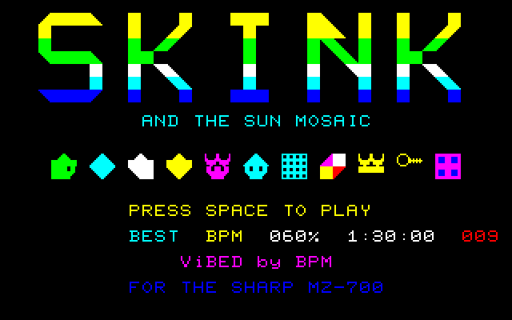
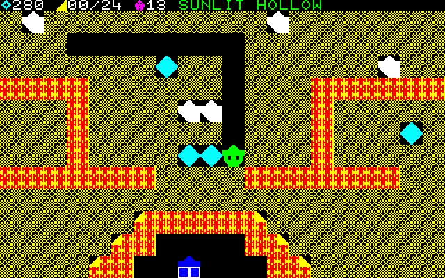
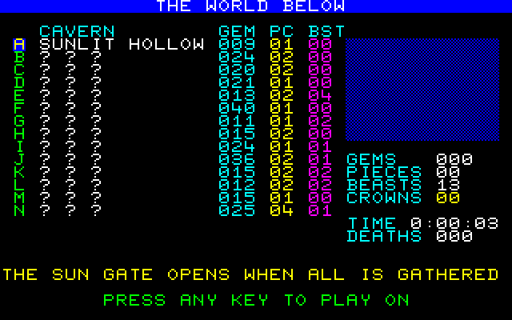
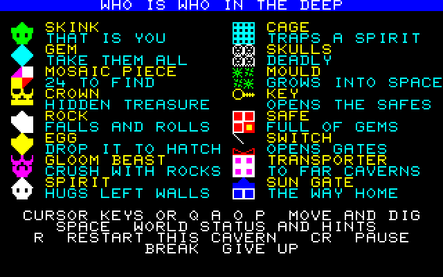
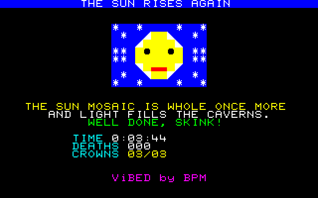

# SKINK and the Sun Mosaic

An underground exploration and puzzle adventure for the **Sharp MZ-700**
(64K, PAL, stock European character ROM, no PCG), in the spirit of the BBC
Micro classic *Repton 2*: one large world of fourteen linked caverns that
remembers everything you do, falling rocks with exact and exploitable
rules, eggs that hatch into beasts, wall-following spirits and their cages,
creeping mould, keys and safes, switches that open gates in far-away
caverns, secret walls and hidden crowns.

Long ago the Sun Mosaic lit the caverns under the Sunlit Hollow. It
shattered into 24 pieces and the Gloom crept in. Guide Skink the lizard
through the deep: gather **every gem**, **every mosaic piece**, and crush
**every gloom beast** (hatched or not). Then the Sun Gate in the Hollow
opens and the game is won. Three crowns are hidden for the curious.

ViBED by BPM.

The blurb, specifications, RAM use, stills and an animated GIF are in
[showcase/](showcase/BLURB.md).

 
 


## Loading

- **Real MZ-700 with a UniCMT (or tape):** copy `release/SKINK.MZF` to the
  stick and load it from the monitor with `L`. It loads at 1200h and starts
  by itself. The whole game is resident in RAM - nothing else is loaded.
- **Emulator (e.g. MZ700WIN):** open `release/SKINK.MZT` (the same file).

No extra hardware is needed.

## Controls

| Key | Action |
|---|---|
| Cursor keys or Q / A / O / P | move, dig, push a rock or egg sideways |
| SPACE | world status screen with a hint for this cavern |
| R | restart this cavern as it was at the start of the game (asks Y/N) |
| CR | pause |
| BREAK | give up (asks Y/N) |
| SPACE on the title | new game |

## The rules

- **Earth** is dug by walking into it. **Rocks** and **eggs** fall into
  space and roll off rocks, eggs, gems and curved walls when the side and
  the cell below the side are free. A rock **resting** on you is harmless;
  a **falling** one kills. You can push a rock or egg sideways into space.
- An **egg** that falls (or rolls) cracks where it lands and hatches into a
  **gloom beast** a moment later. Beasts move towards you through open space
  only (never through earth), along the longer distance first, every other
  tick. They kill if they touch you. A falling rock crushes them.
- **Spirits** move through open space keeping a wall on their left. Earth
  counts as wall, so digging changes their path. A spirit that touches a
  **cage** turns it into a gem. Spirits kill if they touch you.
- **Mould** grows into open space (never into earth) every couple of
  seconds and kills what it reaches.
- **Skulls** kill. Some walls are **secret** and can be dug.
- A **key** turns every **safe** in its cavern into a gem.
- A **switch** opens a set of **gates** - often in another cavern; the
  message line says where.
- **Transporters** link caverns (both ways).
- **Persistence:** every cavern keeps its state when you leave it.
- **Death** puts the cavern back as it was when you came in, and you start
  again at the place you entered. There are no lives; deaths are counted.
- **R** puts the cavern back as it was at the start of the game (switches
  you have thrown stay thrown), so no mistake can make the game impossible.

The top line shows the gems still in the world, the mosaic pieces found,
the beasts and eggs left, and the cavern name (or a message). The status
screen lists every cavern you have visited with what is left in it, shows
the mosaic so far, the totals, play time, deaths and a hint for the cavern
you are in.

## No saving

A game is meant to be played in one sitting, so there is no save. Nothing
can be lost along the way: a death only resets the cavern you are in, and
R resets it to the start without undoing your switches.

## Attract mode

Title with music, a colour-cycling logo, the creatures of the deep and a
scroller; the story; a guide to everything in the caverns; the records
table (best completion, then fastest time); and a **demo** that replays
the opening of the verified solution (any key leaves it).

## The world

Fourteen caverns, 30 x 22 tiles each, every one with its own colour
theme. The Sunlit Hollow is the hub; switches in the first caverns unlock
its other transporters, and later caverns reach back to open vaults in
earlier ones.

| Cavern | Theme | What it teaches / asks |
|---|---|---|
| A Sunlit Hollow | hub | digging, rocks; the Sun Gate; six transporters, four behind gates |
| B Root Cellar | rocks | resting vs falling rocks, a rock pyramid, a plugged switch |
| C Moss Garden | spirits | free a spirit's corridor, dig a tunnel it will follow, time a crossing |
| D Ice Gallery | pushing | push rocks into pits, a one-way rock tunnel, key and safes, skulls |
| E Ember Forge | eggs | drop eggs, then crush the beasts in their shafts |
| F Crystal Vault | secrets | a secret door to a skull maze and the key, 20 safes, a hidden crown |
| G Deep Wells | order | move the rock aside, drop the egg, put the rock back |
| H The Warrens | maze | clear a maze, then let a spirit loose to find the cage |
| I Gold Hall | treasure | gem shelves under rocks, a skull spiral, a crown |
| J Fungus Fen | mould | race the mould for a piece; another egg shaft |
| K Frozen Falls | combination | two eggs and one falling rock, a one-way tunnel, a pit run |
| L Gloom Nest | timing | hold a rock back with your own body until the beast is placed |
| M Spirit Shrine | spirits | two spirits released into a garden with two cages |
| P The Heart | finale | three vaults opened from J, K and L; a shortcut home |

Totals: 280 gems (including caged and safe gems), 24 mosaic pieces, 13
eggs and beasts, 3 crowns, 34 transporter ends, 12 switches.

## Proof that it can be finished

`tools/solution.py` is a complete solution: a list of moves and
waypoints per cavern visit. `tools/solve.py` plays it on a Python model of
the rules with a small pilot that plans safe paths, and checks that every
gem, piece and beast is gone and that the Sun Gate is passed (5609 game
ticks, about 11 minutes, no deaths). `tools/verify.py` then feeds exactly the
same directions, tick by tick, to the real Z80 program in the simulator
and checks that it, too, reaches the Sun Gate - and with `--check` it
compares the whole world with the Python model after every tick.
`py build.py` refuses to build if the solution no longer wins.

Because R restores any cavern to its original state while keeping
thrown switches (switches only ever open gates), any mistake can be
undone, so the game cannot become impossible.

## Building

Needs Python 3 (Pillow only for the preview tools); sjasmplus is in
`tools/`. The simulator needs the MZ-700 character ROM as
`rom/mz700fon.int` (not included).

```
py build.py                     generate data, check the solution, assemble, write build/ and release/
py tools/solve.py               play the solution on the Python model (per-cavern report)
py tools/verify.py [--check]    play the solution on the Z80 build in the simulator
py tools/crosscheck.py 1500 3   random walk: Z80 and Python model compared every tick
py tools/test_frontend.py       title, status screen, give up, records
py tools/perf.py all 600        speed under a conservative VRAM wait model
py tools/showcase.py            stills and an animated GIF in showcase/
py tools/preview.py [KEYS]      render caverns to build/region_K.png
py tools/run.py FIELDS [shots] --keys "field:key,..."   run with scripted keys
```

| Path | What |
|---|---|
| `src/main.asm` | entry, memory map, attract loop |
| `src/world.asm` | packed maps, switches, transporter lookup, world counts |
| `src/physics.asm` | the tick: rocks, eggs, beasts, spirits, mould |
| `src/player.asm` | input, the player's move, collecting, pushing |
| `src/render.asm` | scrolling 2 x 2 tile view, HUD, dissolves |
| `src/game.asm` | play loop, transporters, switches, death, reset, keys |
| `src/status.asm` | world status screen |
| `src/screens.asm` | title, story, guide, records, name entry, ending |
| `src/sound.asm`, `src/sys.asm` | sound player, VBLANK sync, keyboard, helpers |
| `tools/tiles.py` | element codes, 2 x 2 tile looks, colour themes |
| `tools/regions.py`, `tools/world.py` | the caverns and their links |
| `tools/engine.py` | the Python model of the rules |
| `tools/solution.py`, `tools/solve.py` | the solution and its player |
| `tools/music.py`, `tools/logo.py` | music, effects, logo, mosaic picture |

## How it works

- **Tiles.** The MZ-700 has no bitmap mode and no programmable characters,
  so every tile is a 2 x 2 block of ROM glyphs, each with its own colours
  (diamond gems from four triangles, a lumpy rock, horned beasts, a
  hooded spirit, the lizard's face). Every element has 8 animation phases;
  a per-frame table gives each element's current look, and earth and walls
  change with the cavern's theme.
- **Scrolling.** The view is 20 x 12 tiles of a 32 x 24 cavern and keeps
  the player in the middle. A shadow of the look on screen per tile means
  only tiles whose look changed are written, so runs of earth, wall and
  space that line up after a scroll cost nothing.
- **Persistence.** All fourteen caverns live unpacked in RAM (768 bytes
  each, 8F00h-B8FFh); the packed maps (3.4 KB) are only used for a new
  game or a reset. The current cavern is processed in place.
- **Physics** is a top-to-bottom scan per tick (8.3 a second): anything
  that moves right or down is marked so the scan skips it. The rules are
  deterministic (no random numbers), which is what lets the recorded
  solution be replayed exactly.
- **Timing.** Frames are paced with 8253 counter 1, which counts scan
  lines, and start on a VBLANK; so a long frame never loses an extra field
  waiting for the next VBLANK edge. Sound and music run from the same
  field poll on the 8253 square-wave voice.

## Testing done, and what is not tested

- The Python model and the Z80 code agree byte-for-byte on every tick over
  thousands of random ticks and over the whole solution.
- The whole game, from the title to the ending and the records table, has
  been played through in the simulator by the solution.
- Speed under a conservative VRAM wait model: full speed (8.25 of 8.33
  ticks per second while scrolling), about 3% of the CPU lost to waits.
- **Not tested on real hardware.** The simulator does not model the real
  machine exactly, so timing and sound on a real MZ-700 may differ a little.
