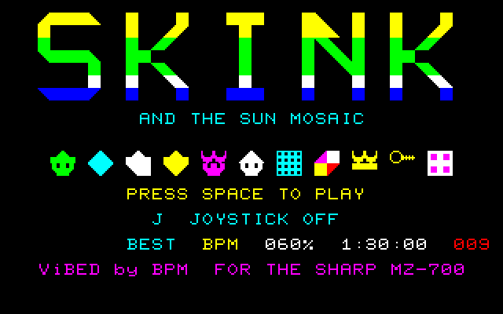
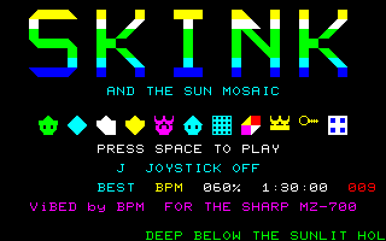
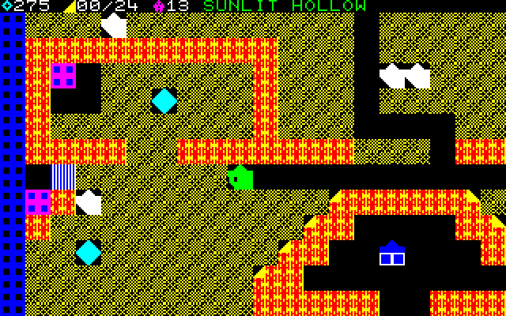
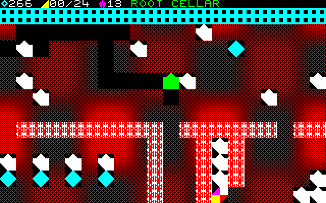
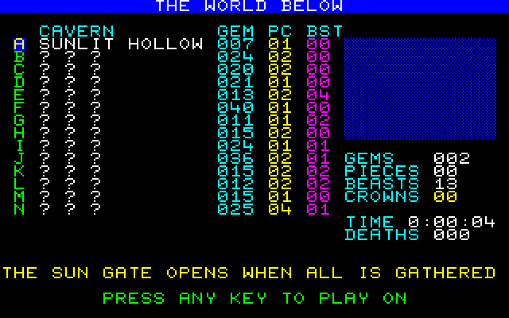

# SKINK and the Sun Mosaic

*An underground exploration and puzzle adventure for the Sharp MZ-700.*
ViBED by BPM.

Long ago the Sun Mosaic lit the caverns beneath the Sunlit Hollow. Then
it shattered into twenty-four pieces and the Gloom crept in: eggs of hungry
beasts, restless spirits and creeping mould. Guide Skink the lizard through
fourteen linked caverns. Dig through earth, bring rocks crashing down on
gloom beasts, lure spirits into their cages, unlock safes, and throw
switches that open gates in far-off caverns. Gather every gem and every
mosaic piece, and crush every beast, hatched or not. Then the Sun Gate
will open.

The caverns remember everything. A rock you drop stays dropped, a tunnel
you dig stays dug, and a gate you open stays open. The rocks follow exact
rules, so every puzzle can be thought through. A death puts back only
the cavern you are in. R resets that cavern to the start and keeps your
switches, so no mistake can make the game impossible. SPACE shows the
whole world: what is left in each cavern, the mosaic so far, and a hint.

| | |
|---|---|
|  |  |
|  |  |

## Features

- 14 linked caverns, each 30 x 22 tiles, each with its own colour theme.
  Between them they hold 280 gems, 24 mosaic pieces, 13 eggs and beasts,
  3 hidden crowns, 34 transporter ends and 12 switches.
- Rocks and eggs that fall and roll; eggs that hatch into beasts that
  hunt you; spirits that hug the left-hand wall and turn cages into gems;
  creeping mould; skulls; keys and safes; secret walls; switches and
  gates.
- A smooth-scrolling 20 x 12 tile view that keeps Skink in the middle.
  Every tile is animated in 8 phases.
- An attract mode: title music, the colour-cycling logo, a parade of the
  creatures and a scroller, then the story, a guide to everything in the
  deep, the records table, and a demo that plays the opening of the
  game's own verified solution.
- A status screen with a hint for each cavern, a records table (best
  completion, then fastest time) with name entry, and an ending.
- Four original tunes and a set of sound effects.
- Keyboard or the Sharp MZ-1X03 joystick (press J on the title).
- Proven completable: a recorded solution plays the whole game from start
  to finish on the real program, and the build refuses to finish if it
  stops winning.

## Technical specifications

| | |
|---|---|
| Machine | Sharp MZ-700, stock: Z80A at 3.5 MHz, 64 KB RAM, PAL |
| Display | 40 x 25 text, 8 colours, built-in European character ROM only (no PCG, no bitmap mode) |
| Sound | 8253 square-wave voice: music and effects from one player |
| Controls | Cursor keys or Q / A / O / P; optional Sharp MZ-1X03 joystick (the stick's pulses are timed from VBLANK) |
| Media | `SKINK.MZF` for a real machine through a UniCMT or tape; `SKINK.MZT` for emulators (identical) |
| File | 20,471 bytes, loads at 1200h and starts by itself; nothing more is loaded |
| Language | Z80 assembly (sjasmplus); build tools and verification in Python |
| Graphics | Each tile is a 2 x 2 block of ROM characters with its own colours; 96 tile looks, 8 animation phases per element |
| Screen updates | A shadow copy of the screen means only tiles whose look changed are redrawn |
| Speed | 25 display frames and 8.3 game ticks a second, held under a pessimistic video-memory wait model (3% of the CPU lost to waits) |
| Timing | Frames are paced with the 8253's scan-line counter, synchronised to VBLANK, so long frames don't lose time |
| World data | 14 caverns stored packed in 3,393 bytes; unpacked into RAM at the start |

### RAM used

| Area | Address | Bytes |
|---|---|---|
| Program, maps, graphics, music, demo | 1200h-61F6h | 20,471 |
| Variables and records table | 6200h-6309h | 266 |
| Game state | 8E00h-8E15h | 22 |
| The whole world, unpacked (14 x 768) | 8F00h-B8FFh | 10,752 |
| Snapshot of the current cavern on entry | C600h-C8FFh | 768 |
| Screen shadow, look table, cavern counts | C900h-CA77h | 360 |
| Stack (top) | below CFF0h | 256 |
| **Total** | | **about 32,900 (32.1 KB)** |

That leaves roughly 14 KB of the MZ-700's 47.5 KB of user RAM (1200h-CFFFh) free (630Ah-8DFFh and B900h-C5FFh). Video and colour RAM (D000h-DFFFh) and the monitor ROM are not counted.
