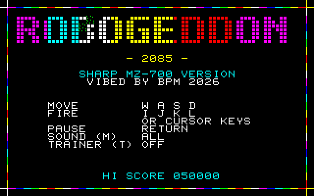
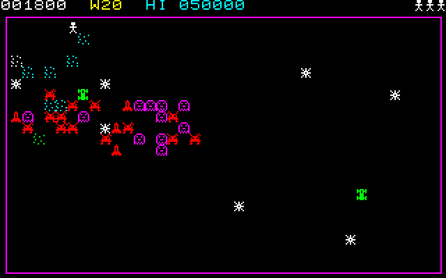

# ROBOGEDDON 2085 (MZ-700)

A twin-stick arena shooter for the **Sharp MZ-700** (64K, PAL, stock European
character ROM, no PCG), played on the keyboard and loaded from tape or a
UniCMT USB cassette emulator.

This is the MZ-700 version of the VZ200/VZ300 game *Robogeddon 2085*: the
same robots, waves and family to rescue, on a blue arena in a green checked
frame. It's inspired by the Robotron style of game but contains nothing from
it. Original code, ViBED by BPM 2026.

 

## Play it

- **Real MZ-700 / UniCMT:** copy `release/ROBOGEDN.MZT` to the USB stick
  (`release/ROBOGEDN.MZF` is the same file under the other common extension)
  and load it like a tape (`L` from the monitor). It loads at 1200h-3079h and
  starts by itself.
- **MZ700WIN:** File > Open `release/ROBOGEDN.MZT`.

## Controls

| Key | |
|---|---|
| **W A S D** | move (8 directions) |
| **I J K L** or the **cursor keys** | fire (8 directions, hold two for diagonals) |
| SPACE | start |
| RETURN | pause (Q quits to the title while paused) |
| M | sound on / off |

You can move one way and shoot another, which is the whole point of the game.

## The game

The robots have risen, and the last human family is wandering the arena.
Shoot every robot to clear the wave, and run into the humans to save them.
Each rescue is worth more than the last (1000, 2000, 3000, 4000, then 5000
each). The count starts again every wave.

| Robot | Points | What it does |
|---|---|---|
| **Droid** (red) | 100 | Marches straight at you, getting faster the longer the wave lasts |
| **Pylon** (star) | 25 | Sits still and kills on touch. Its colour changes from wave to wave |
| **Crusher** (green) | none | Can't be destroyed: shots only knock it back. It wanders, squashes humans (leaving a skull) and you |
| **Mindbot** (magenta) | 500 | Hunts the humans and turns them into **Mutants**, and launches homing missiles |
| **Mutant** (flickering) | 100 | A fast, twitchy ex-human that comes straight for you |
| **Orb** (colour-cycling ring) | 1000 | Bounces around and hatches **Seekers** |
| **Seeker** (yellow) | 150 | Drifts after you and fires sparks |
| **Factory** (colour-cycling box) | 1000 | Bounces around and builds **Tanks** |
| **Tank** (white) | 200 | Lumbers toward you and lobs shells that bounce off the walls |

- Sparks, missiles and shells can be shot down for 25 points.
- 20 waves from the VZ version: droid swarms, crusher waves, mindbot waves and
  tank waves. After wave 20 they repeat. The first ten waves ease you in.
- Each wave's robots materialise line by line, top to bottom, under a caption.
- **Full Family Bonus**: 5000 for a wave where you save someone and lose no one.
- An extra life every 25,000 points. 3 lives to start.

## How it works

- Every sprite is a single character cell drawn with the MZ-700's own ROM
  graphics (the European set's second bank has invaders, robots and little
  people). There is no PCG and nothing is redefined. The title logo is drawn
  with the ROM's 2x2 dot-block characters.
- The game runs at **50 ticks a second**, one tick per PAL field, on every
  wave. The screen is built in RAM in layers: background, then an **object
  layer** where robots, humans and effects are "sticky" (a robot is only
  redrawn when it moves or changes look, and one standing still costs about
  100 T-states a tick), then the work screen with this tick's shots,
  bullets and player on top. In vertical blank, `flush` writes only the
  cells that changed to video RAM.
- Each object-layer cell records which object is showing there. That map is
  also the collision map: a shot or the player only has to look at one byte.
  When an object leaves a cell that another object is hiding in, the cell is
  flagged and the hidden one draws itself again.
- One-voice sound on the 8253, stepped every tick: shots, explosions,
  rescue arpeggios, jingles.
- Objects: up to 80 robots, humans and effects, 16 enemy bullets and 6 shots.

### Speed

In the test model (which assumes video RAM wait states on every line, which
is pessimistic), every wave runs at 50 fps. The busiest, wave 11 with 52
robots, averages about 70% of a field per tick. Wave 20 (14 mindbots and
their missiles) misses the odd field in its first seconds, about 4% of ticks.
At most 5 homing missiles are in the air at once.

### Memory map

| Address | Use |
|---|---|
| 1000h-11FFh | stack (monitor work area; the game never returns to the monitor) |
| 1200h-3079h | code and data |
| 8000h-87FFh | object layer (chars, attributes) |
| 8800h-8BFFh | redraw flags |
| 9000h-99FFh | objects (80 x 32 bytes) |
| A000h-A9FFh | transient lists, background change list, enemy bullets, shots, dirty list |
| B000h-B7FFh | background (chars, attributes) |
| B800h-BFFFh | work screen |
| C000h-C7FFh | shadow of video RAM |
| C800h-CBFFh | owner / collision map |
| CC00h-CFFFh | enemy bullet map |

## Building and testing

Needs Python 3 (Pillow only for screenshots) and
[sjasmplus](https://github.com/z00m128/sjasmplus): put `sjasmplus.exe` in
`tools/sjasmplus/` or on the PATH.

```
py tools/build.py               # -> build/ and release/ROBOGEDN.MZT (+ .MZF)
py tools/play.py play 1500      # scripted game in the MZ-700 model, screenshots in build/shots
py tools/profile.py play 900    # T-states per routine
py tools/verify.py play 1500     # checks VRAM == work screen and every robot is visible, every tick
```

`play.py` scripts: `play`, `stand`, `idle`, `pause`, `title`. Set `WAVE=11`
to start on another wave and `GOD=1` to make the player invincible.
The screenshots need a European CG-ROM image at `rom/mz700fon.int` (not
included).

| Path | What |
|---|---|
| `src/robogeddon.asm` | start-up and main loop; includes the rest |
| `src/screen.asm` | vertical blank, work screen, draw lists, flush, text |
| `src/game.asm` | game states, waves, HUD, scoring |
| `src/objects.asm` | robots, humans, effects: spawning, AI, drawing |
| `src/player.asm` | player, shots, enemy bullets |
| `src/front.asm` | title page and robot gallery |
| `src/keys.asm`, `src/sound.asm` | keyboard matrix, sound effects |
| `src/data.asm` | robot table, waves, difficulty, text |
| `tools/build.py` | logo generator, assembler run, MZT/MZF wrapper |
| `tools/mzemu.py`, `tools/z80.py` | MZ-700 test model (with VRAM wait states) and Z80 |

## Status

Version 0.1: complete and playable in the test model, **not yet tried on
real hardware**. Things to check on a real machine:

- **Keyboard ghosting.** Holding four keys at once (move diagonally while
  firing diagonally) may give phantom key presses if the MZ-700 matrix has no
  diodes. If moving and firing interfere, say which keys, and the fire keys
  can be moved to a different part of the matrix.

Not in this version yet (the VZ version has them): power-ups, high-score
initials, story page, demo mode.
