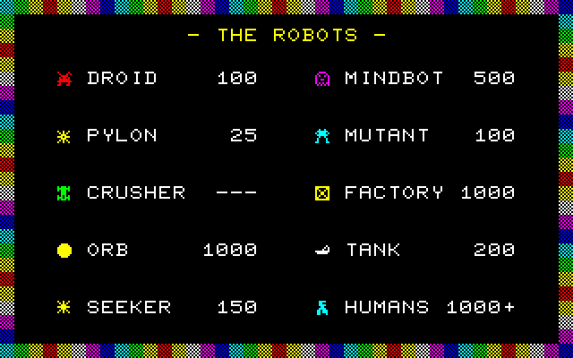
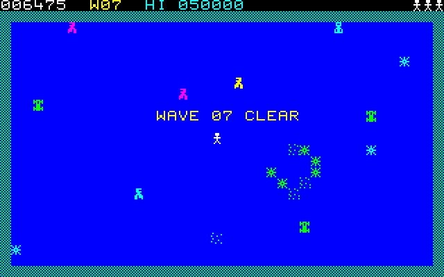
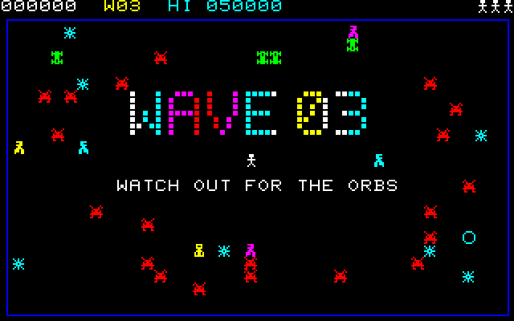
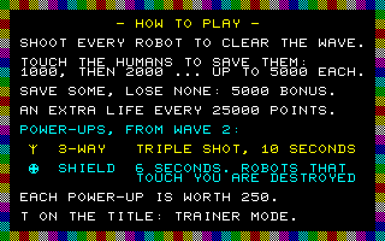

# ROBOGEDDON 2085 (MZ-700)

A twin-stick arena shooter for the **Sharp MZ-700** (64K, PAL, stock European
character ROM, no PCG), played on the keyboard and loaded from tape or a
UniCMT USB cassette emulator.

This is the MZ-700 version of the VZ200/VZ300 game *Robogeddon 2085*: the
same robots, waves and family to rescue, on a black arena in a thin frame
whose colour changes from wave to wave. It's inspired by the Robotron style
of game but contains nothing from it. Original code, music and sound effects,
ViBED by BPM 2026.


 
 
 

## Play it

- **Real MZ-700 / UniCMT:** copy `release/ROBOGEDN.MZT` to the USB stick
  (`release/ROBOGEDN.MZF` is the same file under the other common extension)
  and load it like a tape (`L` from the monitor). It loads at 1200h-4BAFh and
  starts by itself.
- **MZ700WIN:** File > Open `release/ROBOGEDN.MZT`.

## Controls

| Key | |
|---|---|
| **W A S D** | move (8 directions) |
| **I J K L** or the **cursor keys** | fire (8 directions, hold two for diagonals) |
| SPACE | start (from any attract page, or to take over from the demo) |
| RETURN | pause (Q quits to the title while paused) |
| M | sound: ALL (effects + heartbeat) → FX ONLY → OFF (title or in play) |
| T (title) | trainer mode: infinite lives, no high score (a red T in the HUD) |
| A-Z, DEL, RETURN | type your initials for the high-score table |

You can move one way and shoot another, which is the whole point of the game.

## The game

The robots have risen, and the last human family is wandering the arena.
Shoot every robot to clear the wave, and run to the humans to save them: being
next to one (any of the 8 cells round it) is enough.
Each rescue is worth more than the last (1000, 2000, 3000, 4000, then 5000
each). The count starts again every wave.

| Robot | Points | What it does |
|---|---|---|
| **Droid** (red) | 100 | Marches straight at you, getting faster the longer the wave lasts |
| **Pylon** (star) | 25 | Sits still and kills on touch. Its colour changes from wave to wave |
| **Crusher** (green) | none | Can't be destroyed: shots only knock it back. It wanders, squashes humans (leaving a skull) and you |
| **Mindbot** (magenta) | 500 | Hunts the humans and turns them into **Mutants**, and launches homing missiles |
| **Mutant** (flickering) | 100 | A fast, twitchy ex-human that comes straight for you |
| **Orb** (colour-cycling ring) | 1000 | Bounces around and hatches **Seekers** |
| **Seeker** (yellow) | 150 | Drifts after you and fires sparks |
| **Factory** (colour-cycling box) | 1000 | Bounces around and builds **Tanks** |
| **Tank** (white) | 200 | Lumbers toward you and lobs shells that bounce off the walls |

- Sparks, missiles and shells can be shot down for 25 points.
- **40 waves.** The first 20 follow the VZ version (droid swarms, crusher
  waves, mindbot waves, tank waves). Waves 21-40 are new mixes, ending with
  *The Last Stand*. After wave 40, waves 21-40 repeat. The first ten waves
  ease you in.
- **Formations.** Some waves arrange their pylons as an *Electric Fence*
  (a ring), *Corridors of Doom* (two walls) or a *Minefield* (a grid), and
  some start the droids all round the edge (*They're all around you!*).
- Each wave's robots materialise line by line, top to bottom, under a big
  rainbow **WAVE nn** caption. A cleared wave says **CLEAR!** and how many
  humans you saved.
- **Power-ups**, from wave 2. Every 14-24 seconds one appears for 8 seconds
  (it blinks before it goes). Each is worth 250.
  - **3-Way** (yellow trident): every shot is three, a spread of 45°, for
    10 seconds.
  - **Shield** (cyan circled cross): 6 seconds in which bullets can't hurt
    you and robots that touch you are destroyed (crushers just bounce off).
    You flash and throw off a ring of sparks; you blink as it runs out.
  - The HUD shows which one is on.
- **Particles:** robots burst into debris in their own colour, crushers spark
  when you hit them, rescues sparkle, you go out in two bangs, and a cleared
  wave gets fireworks.
- **Heartbeat** (sound mode ALL): a low double thump in the background that
  quickens as the robots thin out.
- **Full Family Bonus**: 5000 for a wave where you save someone and lose no one.
- An extra life every 25,000 points; the arena's edge flashes when you get
  one. 3 lives to start.

## Attract sequence

Left alone, the game cycles through:

1. **Title**: the ROBOGEDDON logo with rolling colours and sparks, a flowing
   rainbow frame, the controls, and the title tune.
2. **The story so far**, typed out a letter at a time while a human runs from
   a line of droids.
3. **The robots**: the rogues' gallery, each robot materialising in turn with
   its name and points.
4. **How to play**: scoring, rescues and the two power-ups.
5. **Demo**: the computer plays a wave (silently). Press SPACE to take over
   with a game of your own.
6. **Robogeddon heroes**: the top 8 scores, initials and wave reached, with
   fireworks. A new entry flashes.

A score good enough for the table asks for your initials after GAME OVER.
The table lasts until you switch off.

## How it works

- Every sprite is a single character cell drawn with the MZ-700's own ROM
  graphics (the European set's second bank has invaders, robots and little
  people). There is no PCG and nothing is redefined. The title logo and the
  big captions are drawn with the ROM's 2x2 dot-block characters (the
  caption font is 5x7 dots per letter, 3x4 characters).
- The game runs at **50 ticks a second**, one tick per PAL field, on every
  wave. The screen is built in RAM in layers: background, then an **object
  layer** where robots, humans and effects are "sticky" (a robot is only
  redrawn when it moves or changes look, and one standing still costs about
  100 T-states a tick), then the work screen with this tick's shots,
  bullets and player on top. In vertical blank, `flush` writes only the
  cells that changed to video RAM.
- Each object-layer cell records which object is showing there. That map is
  also the collision map: a shot or the player only has to look at one byte.
  When an object leaves a cell that another object is hiding in, the cell is
  flagged and the hidden one draws itself again.
- Particles (up to 32) go straight into the work screen and, like the
  robots, are only redrawn when they change cell or look. Half of them move
  each tick, at double speed.
- **Sound** is one voice on the 8253 timer, in the style of the arcade
  machines of the early 80s: everything is built from pitch **sweeps**,
  **warbles** and **noise**, not tunes on a beeper.
  - Each sound is a list of steps (tone, warble, rest, or noise in three
    bands), each with a pitch sweep per tick.
  - Noise is re-rolled continuously while the CPU waits for vertical blank
    (thousands of times a second), so explosions are a real crash and
    rumble rather than 50 Hz grit. It has its own random generator, so sound
    never changes the game.
  - Shots are a short falling laser crack; robots die with a thump, a crash
    and a falling rumble (bigger robots, bigger bang); a rescue is two
    climbing whoops and a shimmer; you die in a crash and a long warbling fall.
  - A new wave growls up out of the dark; game over sinks into a rumble.
  - The title tune: a rising growl and a crash, then a menacing minor
    ostinato with a falling zap at the end of each bar, and a long
    warbling fall.
  - `py tools/sndwav.py` renders all of it to WAV files in `build/sound/`
    from the test model, so you can hear it without the machine.
- Objects: up to 80 robots, humans and effects, 16 enemy bullets and 12 shots (3-Way needs them).
- The demo player looks at the robots every 4th tick: it runs from anything
  within 5 cells, heads for the nearest human, and fires at the robot that is
  nearest and best lined up with one of its 8 shooting directions.

### Speed

The game runs 50 ticks a second, one per PAL field. Ticks are paced on 8253
counter 1, which counts scan lines: a tick that runs past the next vertical
blank doesn't wait for the one after; the next tick starts at once and
catches up (more than three fields behind, it gives up and resyncs). In the
test model (which assumes video RAM wait states on every line, which is
pessimistic) ordinary waves use about 40% of each field; the big waves
(11 on, 50-70 robots, humans and hatchlings) average 80-95% and now hold
49-50 ticks a second where they used to sag to 41-48. At most 5 homing
missiles are in the air at once. `play.py` prints the measured game speed.

### Memory map

| Address | Use |
|---|---|
| 1000h-11FFh | stack (monitor work area; the game never returns to the monitor) |
| 1200h-4BAFh | code and data |
| 8000h-87FFh | object layer (chars, attributes) |
| 8800h-8BFFh | redraw flags |
| 8C00h-8DFFh | particles (32 x 16 bytes) |
| 9000h-99FFh | objects (80 x 32 bytes) |
| A000h-A9FFh | transient lists, background change list, enemy bullets, shots, high scores, dirty list |
| B000h-B7FFh | background (chars, attributes) |
| B800h-BFFFh | work screen |
| C000h-C7FFh | shadow of video RAM |
| C800h-CBFFh | owner / collision map |
| CC00h-CFFFh | enemy bullet map |

## Building and testing

Needs Python 3 (Pillow only for screenshots) and
[sjasmplus](https://github.com/z00m128/sjasmplus): put `sjasmplus.exe` in
`tools/sjasmplus/` or on the PATH.

```
py tools/build.py               # -> build/ and release/ROBOGEDN.MZT (+ .MZF)
py tools/play.py play 1500      # scripted game in the MZ-700 model, screenshots in build/shots
py tools/profile.py play 900    # T-states per routine
py tools/verify.py play 1500     # checks VRAM == work screen and every robot is visible, every tick
```

`play.py` scripts: `play`, `stand`, `idle`, `pause`, `title`. Set `WAVE=11`
to start on another wave, `GOD=1` to make the player invincible, `SEED=n`
for the same random game every run, and `DEMO=n` to go straight to the demo.
`py tools/test_name.py` plays to GAME OVER and types a set of initials;
`py tools/test_power.py` collects a power-up and checks 3-Way and Shield;
`py tools/test_options.py` checks trainer mode and the sound modes.
The screenshots need a European CG-ROM image at `rom/mz700fon.int` (not
included).

| Path | What |
|---|---|
| `src/robogeddon.asm` | start-up and main loop; includes the rest |
| `src/screen.asm` | vertical blank, work screen, draw lists, flush, text |
| `src/game.asm` | game states, waves, HUD, scoring |
| `src/objects.asm` | robots, humans, effects: spawning, AI, drawing |
| `src/player.asm` | player, shots, enemy bullets |
| `src/particles.asm` | debris, sparkles, fireworks |
| `src/fx.asm` | big captions, arena edge flash, heartbeat |
| `src/demo.asm` | the demo's computer player |
| `src/front.asm` | attract pages, high-score table, initials entry |
| `src/keys.asm`, `src/sound.asm` | keyboard matrix, sound effects |
| `src/data.asm` | robot table, waves, difficulty, text |
| `tools/build.py` | logo and caption-font generator, assembler run, MZT/MZF wrapper |
| `tools/mzemu.py`, `tools/z80.py` | MZ-700 test model (with VRAM wait states) and Z80 |
| `tools/sndwav.py` | renders the title tune, every effect and a game to WAV |
| `tools/showcase.py` | showcase stills and GIF from the real build |

## Status

Version 1.0. **Tested on a real European MZ-700**, loaded from a UniCMT:
moving and firing diagonally at once (four keys held) works, DEL works, and
the sound is right.

`showcase/` has the blurb with the tech specs and RAM table
([showcase/BLURB.md](showcase/BLURB.md)), gameplay and attract stills, and a
showcase GIF, all made by `py tools/showcase.py` from the real build.

Everything in the VZ version is now in, apart from keeping the high scores
when you switch off (the VZ saves them in its SRAM card; the MZ-700 has
nowhere to keep them).
