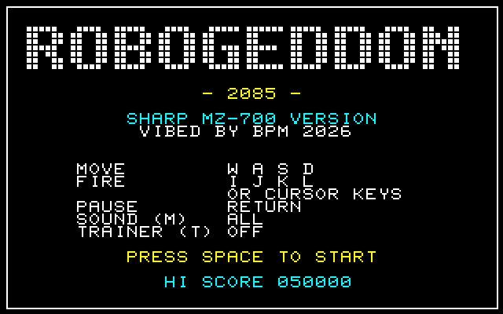
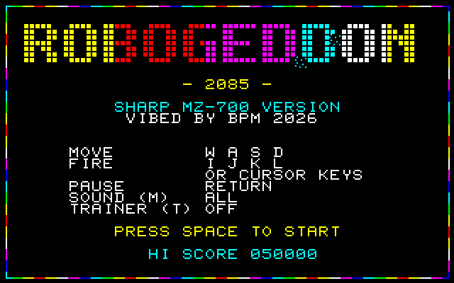
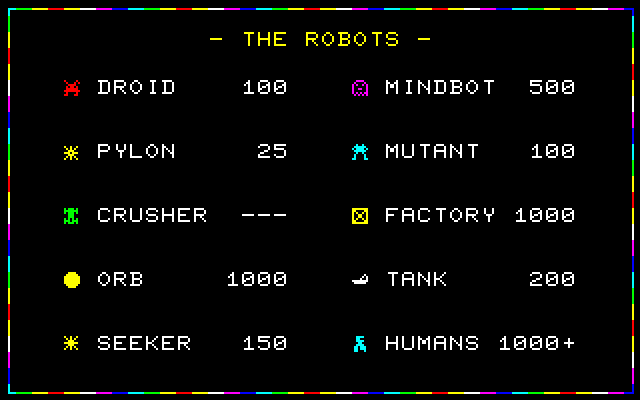
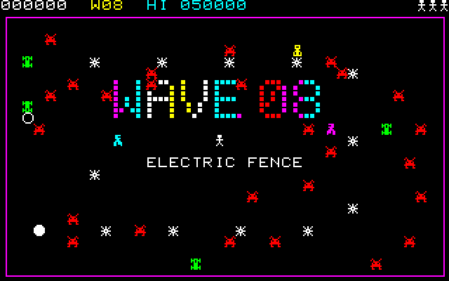
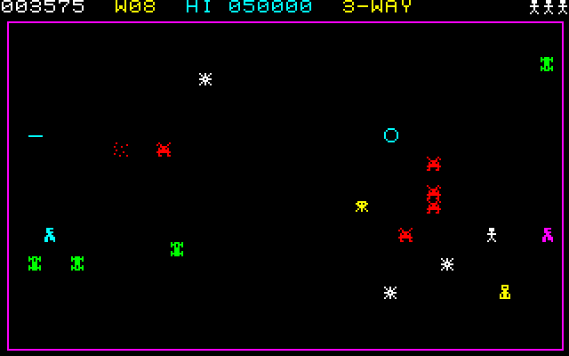
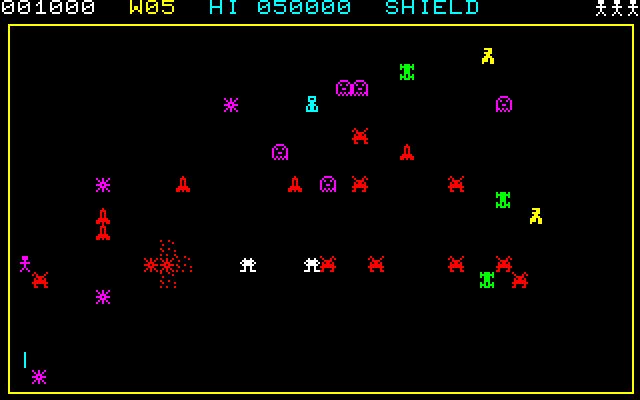
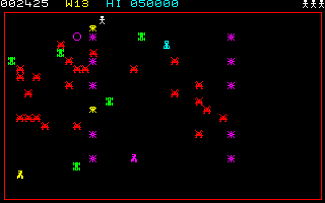
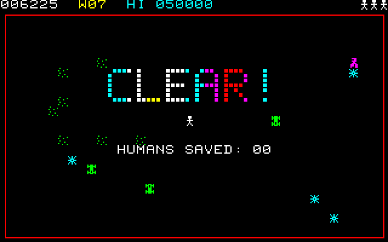
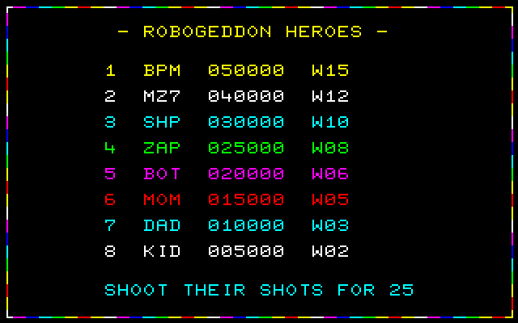

# ROBOGEDDON 2085

*Twin-stick robot mayhem for the Sharp MZ-700, played on the keyboard.*
ViBED by BPM 2026.

**The year is 2085, and the machines have turned on us.** One family is
left alive, wandering an arena full of murderous robots, and only you stand
between them and the scrap heap.

**Move with one hand and blast with the other.** W A S D moves you in eight
directions; I J K L or the cursor keys fire in eight more, so you can run
one way and shoot another. ROBOGEDDON is frantic arcade-style arena action
in the spirit of the early-80s classics. You carve paths through swarms of
droids while you dive across the arena to pull the last humans to safety.
Every wave materialises line by line under a giant rainbow caption, and
every robot you hit bursts apart in a shower of debris in its own colour.
There's no time to think, only to move and shoot, and to keep moving.

| | |
|---|---|
|  |  |
|  |  |
|  |  |
|  |  |

## Forty waves of mayhem

- **Droids** march straight at you, and the longer you take, the faster
  they come.
- **Pylons** kill on touch, and some waves build them into an *Electric
  Fence*, *Corridors of Doom* or a *Minefield*.
- **Crushers** can't be stopped. Bullets only knock them back, and they
  flatten any human they catch.
- **Mindbots** hunt your family, turn them into twitching **Mutants**, and
  launch homing missiles.
- **Orbs** bounce around hatching spark-spitting **Seekers**.
- **Factories** roll out **Tanks** that lob shells off the walls.

Save the humans for 1,000 to 5,000 points apiece. Grab **3-Way** spread
shot and the **Shield** (robots that touch you are destroyed), earn the
**Full Family Bonus**, and pick up an extra life every 25,000 points. The
first ten waves ease you in; waves 21-40 are new mixes, ending with
*The Last Stand*.

## All the trimmings

- A full attract sequence: the colour-rolling ROBOGEDDON logo with sparks
  flying off it and a menacing title tune; the story, typed out while a
  human flees a line of droids; the rogues' gallery, each robot
  materialising in turn; a How to Play page; a demo in which the computer
  plays (press SPACE to take over); and the **Robogeddon Heroes** table,
  with fireworks.
- A high-score table with initials (type them, DEL rubs out) and the wave
  you reached.
- Arcade-style sound in the spirit of the Williams machines of the day:
  laser-crack shots, thump-crash-rumble explosions, whooping rescues, a
  warbling death, a wave that growls up out of the dark, and a heartbeat
  that quickens as the robots thin out.
- Particles everywhere: debris, crusher sparks, rescue sparkles, a
  two-stage death, the Shield's ring of sparks, fireworks.
- Trainer mode (T on the title) for practice, a pause key, and three sound
  modes (all, effects only, off).
- Tested on a real European MZ-700 loaded from a UniCMT: diagonal moving
  and shooting together, every key, and the sound.

## Technical specifications

| | |
|---|---|
| Machine | Sharp MZ-700, stock: Z80A at 3.5 MHz, 64 KB RAM, PAL |
| Display | 40 x 25 text, 8 colours, built-in European character ROM only (no PCG, no bitmap mode) |
| Graphics | Every robot, human, shot and particle is one ROM character, from both of the ROM's 256-character banks. The logo and the big captions are drawn with the ROM's 2 x 2 dot blocks |
| Speed | 50 game ticks a second, one per PAL field, held at 49-50 even on the busiest waves (under a pessimistic video-memory wait model) |
| Timing | Ticks are paced on the 8253's scan-line counter: a tick that runs late doesn't wait for the next vertical blank, the next one starts at once to catch up |
| Rendering | Three layers in RAM (background; a "sticky" object layer where a robot is redrawn only when it moves or changes look, about 100 T-states a tick for one standing still; and the shots, bullets and player on top) and a shadow of video RAM, so only cells that changed are written to the screen, in vertical blank |
| Collisions | The object layer's owner map is also the collision map: a shot or the player looks at one byte |
| Objects | Up to 80 robots, humans and effects, 16 enemy bullets, 12 player shots and 32 particles at once |
| Sound | One voice on 8253 counter 0: an engine of pitch sweeps, warbles and three bands of noise. Noise is re-rolled continuously while the CPU waits for vertical blank, on its own random generator |
| Input | The keyboard matrix is scanned every tick; any mix of the 8 movement and 8 firing directions works together |
| Media | `ROBOGEDN.MZF` for a real machine through a UniCMT or tape; `ROBOGEDN.MZT` for emulators (identical) |
| File | 14,676 bytes (plus the 128-byte tape header), loads at 1200h and starts by itself; nothing more is loaded |
| Language | Z80 assembly (sjasmplus), about 6,300 lines; build, test and showcase tools in Python (an MZ-700 model with video-memory wait states, a renderer invariant checker, a WAV renderer for the sound) |

### RAM used

| Area | Address | Bytes |
|---|---|---|
| Program, graphics, waves, sound, text, variables | 1200h-4B53h | 14,676 |
| Object layer (characters, attributes) | 8000h-87FFh | 2,048 |
| Redraw flags | 8800h-8BFFh | 1,024 |
| Particles (32 x 16) | 8C00h-8DFFh | 512 |
| Objects (80 x 32) | 9000h-99FFh | 2,560 |
| Draw lists (2) and background change list | A000h-A5FFh | 1,536 |
| Enemy bullets, player shots, high scores | A600h-A6FFh | 256 |
| Dirty list | A800h-A9FFh | 512 |
| Background, work screen, video RAM shadow (characters, attributes) | B000h-C7FFh | 6,144 |
| Owner / collision map, bullet map | C800h-CFFFh | 2,048 |
| Stack (in the monitor's work area, below 1200h) | 1000h-11FFh | (512) |
| **Total** | | **31,316 (30.6 KB)** |

That leaves 17,324 bytes (16.9 KB) of the MZ-700's 47.5 KB of user RAM
(1200h-CFFFh) free: 4B54h-7FFFh, 8E00h-8FFFh, 9A00h-9FFFh, A700h-A7FFh and
AA00h-AFFFh. Video and colour RAM (D000h-DFFFh) and the monitor ROM are
not counted.
