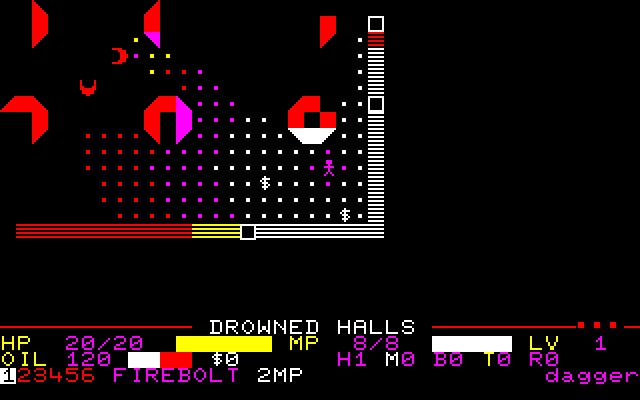
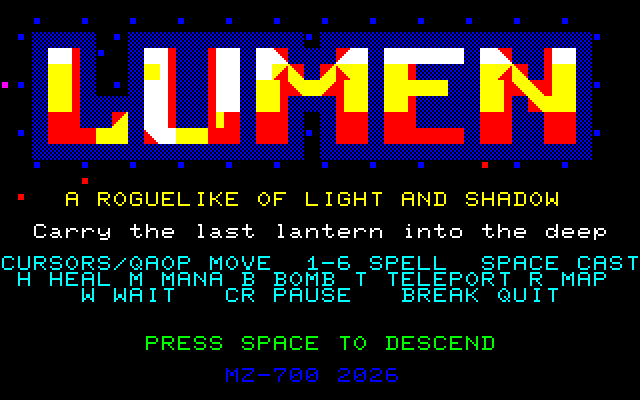
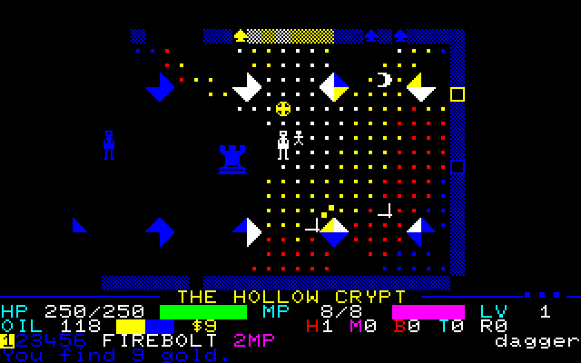
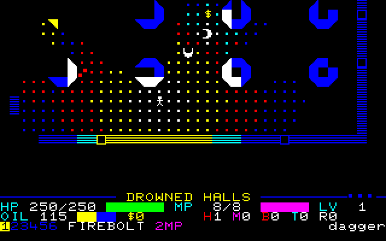
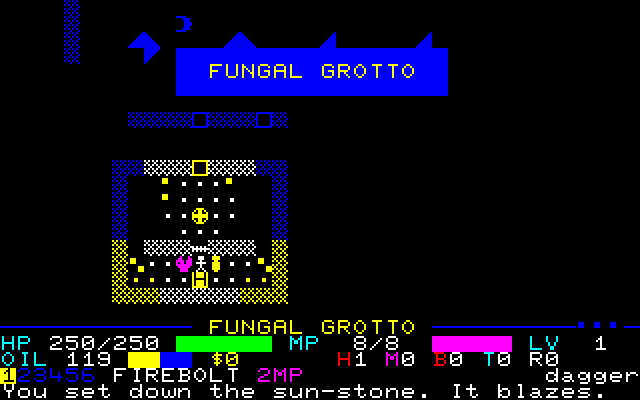
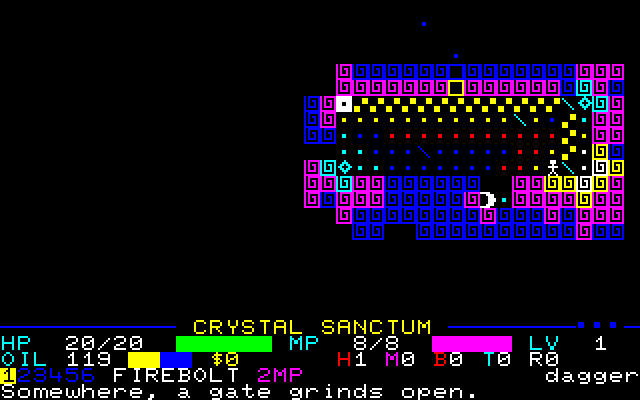
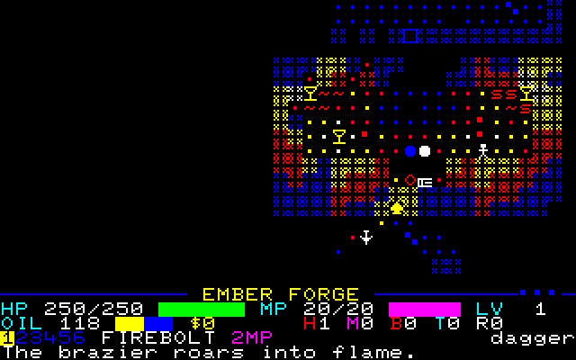
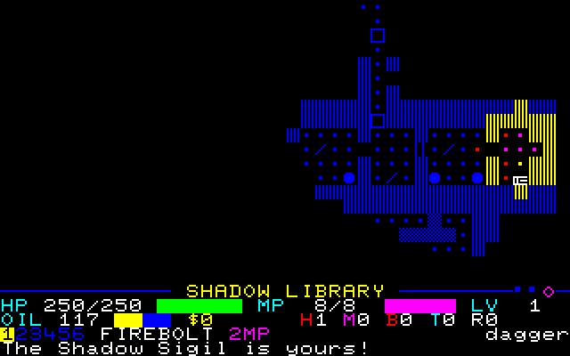
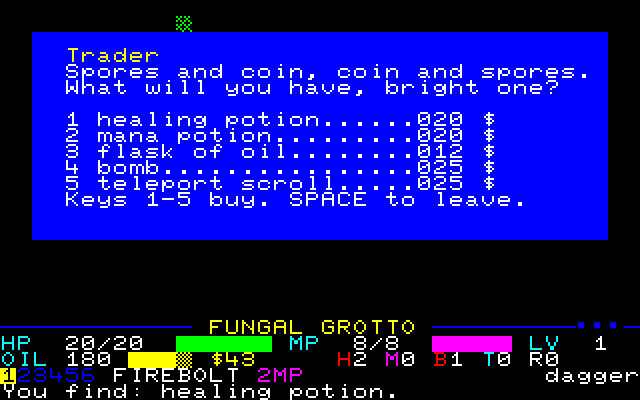

# LUMEN

*A roguelike of light and shadow for the Sharp MZ-700.*

The Lightless King has drunk every flame in the deep. You carry the last lantern.

Every cell on screen is lit as you play: line-of-sight rays from your flickering lantern, braziers and
sconces casting their own shadows past pillars, glowing fungus and crystals, lava, a beam of sunlight
steered by mirrors, and spells that carry their light with them as they fly. Light carries a long way, fanning out
between columns, statues and great braziers and spilling down corridors. Light is coloured — warm,
cold, toxic, arcane, sunlit — and the dungeon takes on the colour of what lights it. Some creatures can
only be seen when the light is strong enough.

- Eight interconnected zones, generated anew each game, each with its own look and inhabitants
- Puzzle vaults: boulders and pressure plates, braziers across lava, an ice hall, lever gates, a sigil
  seal, mirrors and a sun beam
- 31 kinds of creature, 6 spells, 7 folk who teach, trade and heal, weapons, armour, potions, bombs
- The sun-stone: carry a relic of daylight, or set it down to open doors of dark glass
- Lantern oil to manage, particles everywhere, tracker title music, an AI attract demo

| | |
|---|---|
| Machine | Sharp MZ-700, 64K, European CG-ROM; no PCG or expansions |
| File | LUMEN.MZT / LUMEN.MZF, 28.5 KB, loads at 1200h |
| Display | 40 × 25 characters, 8 colours; 25 frames a second |
| Sound | 8253 tone generator: tracker music and two effect channels |
| RAM | all 64K, including the RAM under the monitor ROM and behind VRAM |

 
 
 
 
