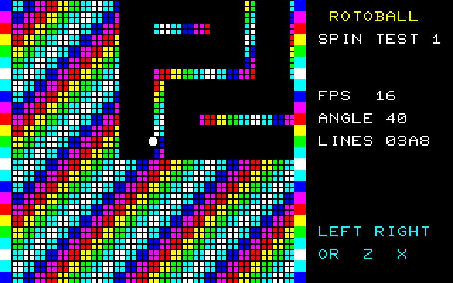

# Rotoball (working title)

A rotating-maze ball game for the **Sharp MZ-700** (64K, PAL, stock European
character ROM, no PCG), loaded from tape or a UniCMT USB cassette emulator.

You turn the maze, not the ball. The ball stays in the centre of a 25x25
character window, gravity always pulls down the screen, and the whole maze
rotates around it in real time.



## Status: milestone 1 - spin test

- Real-time rotating maze at **16.7 fps** (3 video fields per frame),
  measured in the simulator, whether or not you are turning
- Ball physics: gravity follows the rotation, wall collisions, bounces
- Colour-cycling rainbow walls and border
- Sound: clink on hard bounces, gritty hiss while spinning
- On-screen frame timer (FPS / scan lines per frame) for checking on real hardware

Controls: **Left / Right** cursor keys (or **Z / X**) rotate the maze.

## Running it

- **Real MZ-700 / UniCMT:** copy `release/ROTOBALL.MZF` to the USB stick and
  load it like a tape (`L` from the monitor). It runs from 1200h.
- **MZ700WIN:** File > Open `release/ROTOBALL.MZT` (the same file, renamed).

## Building

Needs only Python 3 (no packages):

```
py build.py
py tools/run_test.py path\to\mz700-font.rom     (optional: simulator run + screenshots)
```

| Path | What |
|---|---|
| `src/rotoball.asm` | the game (Z80) |
| `tools/gen_data.py` | sine tables, test maze, unrolled renderer/blit code |
| `tools/zasm.py` | small two-pass Z80 assembler |
| `tools/z80.py`, `tools/mzsim.py` | Z80 + MZ-700 simulator used for timing and screenshots |
| `tools/run_test.py` | scripted simulator run, writes `build/shots/*.png` |

No ROM images are included; the simulator uses a character ROM file only if
you pass one.

## How the rotation works

The maze is a 256-column x 96-row byte map at 6000h (bit 7 = wall). Every
frame the view is resampled at the current angle into the 16 dotted 2x2
block characters F0h-FFh, giving a 50x50 "pixel" image:

- Each block row starts from its exact map position, rounded to half a cell.
- Per angle, four lists of 50 pointer deltas are precomputed, one for each
  half-cell phase. Drawing a block row is then just `pop de / add hl,de /
  ld a,(hl) / rla / rl c`: 40 T-states per sample.
- Rows are drawn right to left, lower block row first, so the four wall bits
  land in C exactly as the character code wants them
  (bit0 TL, bit1 TR, bit2 BL, bit3 BR).
- The back buffer is copied to VRAM at vertical blank with unrolled `LDI`s.

Rendering takes about 150K of the ~212K T-states in three fields. The
simulator does not model VRAM wait states, so the on-screen FPS readout
on real hardware is the number to trust.
