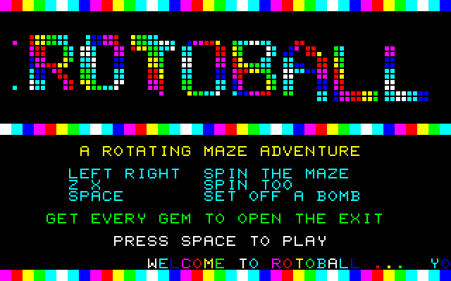
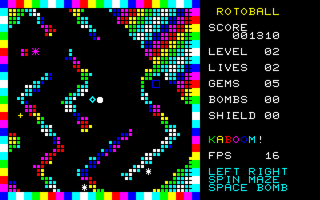

# Rotoball (working title)

A rotating-maze ball game for the **Sharp MZ-700** (64K, PAL, stock European
character ROM, no PCG), loaded from tape or a UniCMT USB cassette emulator.

You turn the maze, not the ball. The ball stays in the centre of a 23x23
character window, gravity always pulls down the screen, and the whole maze
rotates around it in real time.




## How to play

| Key | Action |
|---|---|
| Left / Right (or Z / X) | rotate the maze |
| SPACE | start a game from the title; set off a bomb (if you have one) |

- Collect every **gem** (sparkling diamond) to open the **exit** (blue box,
  which turns into a pulsing ring). Roll into the open exit to clear the level.
- **Mines** (flickering spikes) kill you on contact.
- **Crawlers** (walking bugs) patrol the corridors. Land on one from above,
  falling with gravity, to squash it and bounce off. Any other touch kills you.
- **Bomb** pickups: SPACE blasts the level walls around you and destroys
  nearby mines and crawlers.
- **Shield** pickups (circled cross): about 9 seconds of invulnerability, and
  anything you touch is destroyed.
- 8 levels that get bigger and busier, 3 lives. Score: gem 50, crawler 100,
  bombed enemy 50, exit 1000.

## Status: milestone 3 - title, attract mode, music, high scores

- **Title screen:** the ROTOBALL logo is itself rotozoomed across the full
  screen width. It sways, pulses in size and does a full spin every ~8 s over
  a rotating lattice of stars, with rainbow marquees and a scrolling message.
  Pages cycle: instructions, a sprite legend, and the high-score table.
- **Attract mode:** after the pages, the game plays level 1 by itself. An
  autopilot tilts the maze to steer gravity along a route that
  `tools/levels.py` works out (nearest gem first, then the exit). Any key
  returns to the title.
- **Music:** an original tune on a three-channel player (lead, bass and drums
  on the single 8253 voice). Lead and bass alternate tick by tick, and kick,
  snare and hat hits cut in.
- **High scores:** a top-5 table. Enter three initials with LEFT/RIGHT and
  SPACE after a qualifying game.
- The title code runs from the RAM under the monitor ROM (0000h-0FFFh),
  switched in with `OUT (E0h)` and copied there at start-up.

Milestone 2 (the game itself):

- Real-time rotating maze at **16.7 fps** (3 video fields per frame) in the
  simulator, with about 20K T-states spare while turning
- 8 generated levels, gems/exit, mines, crawlers, bombs, shields, lives, score
- Objects drawn as overlay sprites from the European set's second character
  bank, projected into the rotated view every frame, with 4-frame animation
- Colour-cycling rainbow walls, marquee frame, flashes on bombs and deaths
- One-voice sound engine ticking about 7 times per frame (inside the renderer):
  clinks, chinkly gem arpeggios, squelchy stomps, noise bombs, death sweep,
  and jingles with melody and bass interleaved tick by tick
- On-screen frame timer (FPS) for checking on real hardware

Ideas for next: more enemy types (bouncers, chasers), hand-designed levels,
in-game music, a faster tape loader.

## Running it

- **Real MZ-700 / UniCMT:** copy `release/ROTOBALL.MZF` to the USB stick and
  load it like a tape (`L` from the monitor). It runs from 1200h.
- **MZ700WIN:** File > Open `release/ROTOBALL.MZT` (the same file, renamed).
  MZ700WIN does not emulate the 8253 counter the frame timer reads, so it
  shows `FPS --` there.

## Building and testing

Needs only Python 3 (no packages):

```
py build.py
py tools/test_game.py path\to\mz700fon.int      (scripted gameplay checks + screenshots)
py tools/test_demo.py path\to\mz700fon.int      (title frame rate, attract-mode autopilot)
py tools/profile.py 90 right                    (T-states per routine while turning)
```

| Path | What |
|---|---|
| `src/rotoball.asm` | main loop; includes the modules below |
| `src/render.asm` | rotating renderer, delta lists, VRAM copy, colours, overlay |
| `src/game.asm` | game states, level loading, lives, bombs, score |
| `src/objects.asm` | objects, collisions, stomping, projection into the view |
| `src/physics.asm` | keys, rotation, ball physics |
| `src/sound.asm`, `src/sndtick.inc` | sound effect player |
| `src/hud.asm` | status panel, messages, frame timer |
| `src/music.asm` | three-channel music player |
| `src/title.asm` | title, attract cycle, high-score entry (runs at 0000h) |
| `src/titledata.asm` | title pages, scroller text, high-score table |
| `tools/music.py` | the title tune |
| `tools/levels.py` | level generator (`py tools/levels.py` prints them as ASCII) |
| `tools/sfx.py` | sound effects and jingles |
| `tools/gen_data.py` | tables and unrolled renderer code |
| `tools/zasm.py` | small two-pass Z80 assembler |
| `tools/z80.py`, `tools/mzsim.py` | Z80 + MZ-700 simulator |
| `tools/fontsheet.py` | draws a CG-ROM as a labelled PNG |

No ROM images are included. The simulator uses a character ROM file only if
you pass one.

## How the rotation works

The maze is a 256-column x 96-row byte map at 6000h (bit 7 = wall). Every
frame the view is resampled at the current angle into the 16 dotted 2x2
block characters F0h-FFh, giving a 46x46 "pixel" image:

- Each block row starts from its exact map position, rounded to half a cell.
- Per angle, four lists of 46 pointer deltas are precomputed, one for each
  half-cell phase. Drawing a block row is then just `pop de / add hl,de /
  ld a,(hl) / rla / rl c`: 40 T-states per sample.
- Rows are drawn right to left, lower block row first, so the four wall bits
  land in C exactly as the character code wants them
  (bit0 TL, bit1 TR, bit2 BL, bit3 BR).
- The back buffer is copied to VRAM at vertical blank with unrolled `LDI`s.

Objects are not in the map. Each frame, every object within 17 cells is
projected with quarter-square multiplies into a character cell of the view and
drawn on top, with its own colour.
