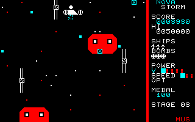
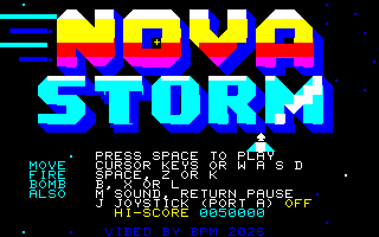
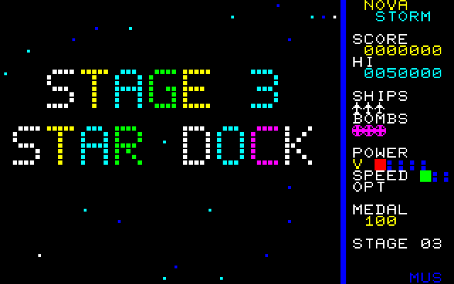
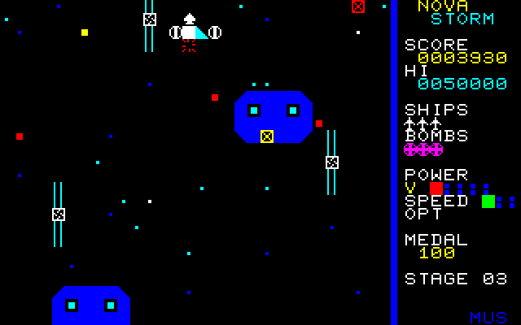
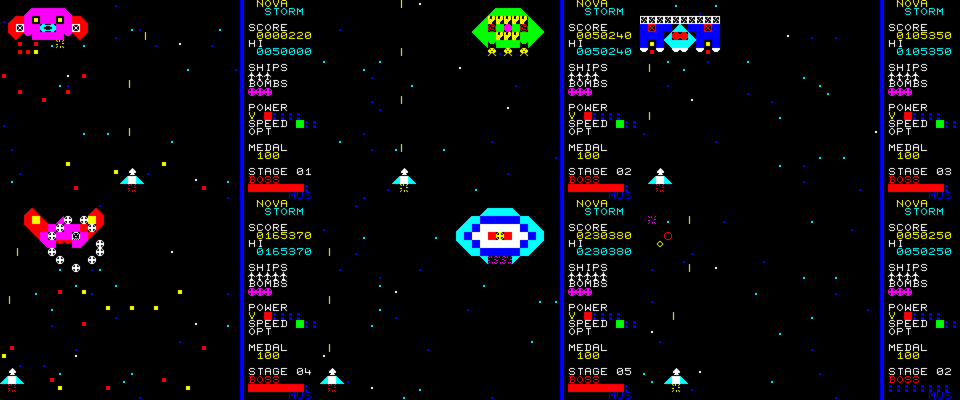
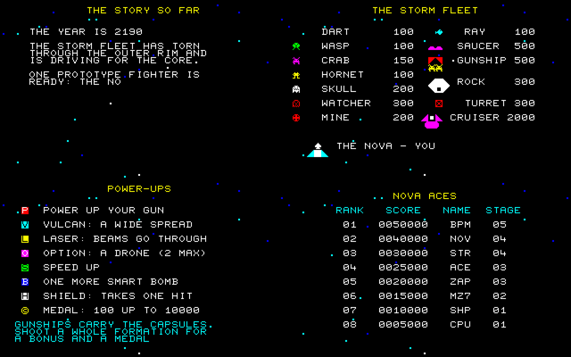
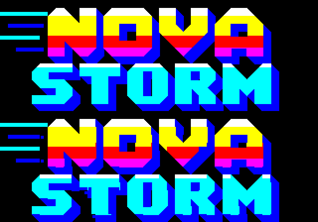

# NOVA STORM (MZ-700)

A vertically scrolling space shoot-'em-up for the **Sharp MZ-700** (64K, PAL,
stock European character ROM, no PCG), loaded from tape or a UniCMT USB
cassette emulator. It is an original game: original code, graphics, music
and sound effects. ViBED by BPM 2026.



 
 


## Play it

- **Real MZ-700 / UniCMT:** copy `release/NOVASTRM.MZT` to the USB stick
  (`release/NOVASTRM.MZF` is the same file under the other common extension)
  and load it like a tape (`L` from the monitor). It loads at 1200h-7184h and
  starts by itself.
- **MZ700onPC / MZ700WIN:** open `release/NOVASTRM.MZT`.

## Controls

| Key | |
|---|---|
| **Cursor keys** or **W A S D** | move |
| **SPACE**, **Z** or **K** | fire (hold it down) |
| **B**, **X** or **L** | smart bomb |
| SPACE (title) | start, from any attract page or to take over from the demo |
| RETURN | pause (Q quits to the title while paused) |
| M | sound: MUSIC + FX → FX ONLY → OFF (shown at the bottom of the HUD) |
| J (title) | MZ-1X03 joystick in port A on/off: stick moves, button 1 fires, button 2 bombs |
| A-Z, DEL, RETURN | type your initials for the high-score table |

## The game

The Storm Fleet has broken through the Outer Rim. Fly the prototype fighter
NOVA through five sectors, each ending with one of the fleet's warlords:

| Stage | Sector | Scenery | Boss |
|---|---|---|---|
| 1 | OUTER RIM | asteroid belt, a moon | **Warden**: a battle cruiser with aimed spreads, fans and twin guns |
| 2 | NEBULA | blue and magenta clouds, planets | **Hive Mother**: launches hornets and skulls, spirals and rings |
| 3 | STAR DOCK | decks, hulls and pylons with gun turrets | **Dock Fortress**: hunts your column, rains bullets |
| 4 | COMETS | comets and rocks (a faster scroll) | **Twin Claw**: claw spreads, spirals and rings |
| 5 | THE CORE | the fleet's own hull, turrets everywhere | **Overmind**: rings, long spirals, summons watchers |

Every boss has a second, nastier attack script below half its strength (the
HUD bar shows what's left). After stage 5 the game goes round again, faster
and with tougher enemies and more boss armour.

**Enemies:** darts that dive (some home in), weaving wasps, crab formations
that stop and sway, hornets that swoop in from the sides, homing skulls,
watchers that stop and fire spreads, mines that burst into rings, rays,
bonus saucers, red gunships that carry power-ups, rocks that split into
chips, ground turrets on the scenery, and heavy cruisers (mid-bosses).

**Power-ups** (capsules carried by gunships and cruisers):

| Capsule | |
|---|---|
| **P** | power up the gun (5 levels) |
| **V** | VULCAN: a spread, up to 5 streams (if you already have it: power up) |
| **L** | LASER: piercing beams, up to 3 (if you already have it: power up) |
| **O** | option: a drone that trails you and fires too (2 at most) |
| **S** | speed up (3 steps) |
| **B** | one more smart bomb (6 at most) |
| **H** | shield: takes one hit |

Capsules you can't use any more are worth 1000.

**Bonuses:**
- **Medals** (yellow, from saucers, cruisers and whole formations) are worth
  100, 200, 500, 1000, 2000, 5000, then 10,000 each: catch them in a row.
  Let one fall off the bottom and the value starts again at 100.
- **Formation bonus:** shoot down every member of a wave (3 or more) for
  1000 points and a medal.
- **Stage clear tally:** 10,000 for a stage without losing a ship, 1000 for
  each bomb left, and 500 per medal level.
- An extra ship at 50,000 and every 100,000 after.

Losing a ship costs one power level, your options and your speed; you
come back with at least 2 bombs and 3 seconds of grace.

## Attract sequence

Left alone, the game cycles through the **title** (the NOVA STORM logo with
a shine sweeping across it and a star twinkling in the O, a ship on patrol
and the title tune), **the story so far**
(typed out), **the Storm Fleet** (every enemy with its points), the
**power-ups**, a **demo** (the computer plays one of the first three stages,
silently; SPACE takes over), and the **high scores** (NOVA ACES).
Stars drift behind every page.

## How it works

- **Screen:** 30 columns of playfield and a 9-column HUD. Every sprite is
  built from the ROM's own characters: the first bank's solid blocks,
  half blocks and triangles for the ships, bosses and scenery, the second
  bank's invaders, saucers and balls for the small enemies. Nothing is
  redefined. The big captions use the 2x2 dot blocks.
- **The logo** is drawn as an ordinary picture first (`tools/logo.py`):
  chamfered letters whose every slanted edge runs 45 degrees from cell
  corner to cell corner, colour bands on half-cell lines, a one-cell 3D
  extrusion and speed streaks. A converter then matches each 8x8 piece
  against the ROM's block, wedge, line and quarter glyphs with every
  foreground/background colour pair, and keeps the best. Because the
  picture is designed on the glyphs' own geometry, almost every cell
  matches exactly (`docs/logo_convert.png`: the picture above, the MZ-700
  version below).

  
- **25 ticks a second**, paced on 8253 counter 1 (which counts scan lines):
  a tick that runs long doesn't wait for the next blank but starts at once
  and catches up, so the game keeps its speed through busy moments. Every
  stage measures 99% of 25 ticks a second in the emulator.
- **Rendering:** each tick builds a work screen in RAM: the background
  (stars, scenery, HUD) plus this tick's sprites. At the next vertical blank
  only the cells that differ from a shadow of video RAM are written. Sprite
  cells go on a draw list, and last tick's list is used to put the
  background back.
- **Scrolling:** the scenery lives in a ring of 32 rows. A scroll step moves
  the ring's top and adds the next row of each scenery piece coming in.
  The renderer compares each screen row with the ring row that was there
  before and rewrites only the cells that changed (the edges of a planet,
  not its middle), so open space costs nothing. The stars are three
  layers of single cells moving at different speeds behind the scenery.
- **Collisions:** sprites write their owner into a collision map as they
  are drawn: a shot looks at one byte. Only the centre column of your ship
  (nose and body) can be hit.
- **Bosses** run attack scripts: steps of (action, gun, parameter, repeats,
  gap), where an action is an aimed shot, an aimed spread, a fan, a ring,
  a spiral, rain, twin guns or a launched enemy.
- **Sound** is one voice on 8253 counter 0, which plays a square wave by
  itself, so it costs almost no CPU. The music is a 50 Hz tracker arranged
  at build time in the demoscene way: a falling kick into the bass on beats
  1 and 3, a snare click on 2 and 4, plucked melody notes with vibrato on
  held ones, and chord arpeggios in every gap (title, two stage themes,
  boss, stage clear, game over). Effects run in two slots about 100 times a
  second and take turns when both are busy; while either plays the music
  waits. Noise is re-rolled all the time the CPU waits. Sound ticks come from
  the scan-line clock, so none are lost while the game works.
- **Demo pilot:** every other tick it builds a 7 x 6 danger map round the
  ship (where each bullet will be over the next 4 ticks, and the enemies),
  scores the 9 possible moves, prefers lining up under a capsule, the
  lowest enemy or the boss, always fires, and bombs when cornered.
- **Joystick:** the MZ-1X03 reports its position as the length of a pulse
  after the vertical blank starts. The game times the pulses for both axes
  and takes the first reading after J as the centre, so it doesn't depend
  on any one model of the timing. Not yet tried on a real stick.

### Memory map

| Address | Use |
|---|---|
| 1000h-11FFh | stack |
| 1200h-7184h | code and data |
| 8000h-87FFh | scenery ring (32 x 32 chars, attributes) |
| 8800h-8FFFh | background |
| 9000h-97FFh | work screen |
| 9800h-9FFFh | shadow of video RAM |
| A000h-A3FFh | collision map |
| A400h-AFFFh | draw lists (2 x 512 cells), background change list |
| B000h-B2FFh | enemies (24 x 32 bytes) |
| B400h-B57Fh | enemy bullets (48 x 8) |
| B600h-B73Fh | shots (40 x 8) |
| B800h-B8FFh | explosions, sparks, debris, pop-ups (32 x 8) |
| B900h-BBFFh | stars, wave spawners, scenery pieces entering |
| BC00h-BFFFh | high scores, option trail, capsules, scenery bookkeeping |

## Building and testing

Needs Python 3 (Pillow only for previews) and
[sjasmplus](https://github.com/z00m128/sjasmplus): put `sjasmplus.exe` in
`tools/sjasmplus/` or on the PATH.

```
py tools/build.py            # data (gen.py, music.py), assembly -> release/NOVASTRM.MZT + .MZF
py tools/preview.py          # every sprite, boss and scenery piece -> build/art.png
py tools/run.py tests/X.txt  # an MZ700onPC mzemu script, {symbol} replaced by its address
```

Testing uses the shared emulator `..\MZ700onPC\mzemu.exe`. Test hooks (poke
them after `mzt`): `godmode` 1 (can't be hit), `startstage` n, `skipto` n
(start each stage 2n rows in, e.g. 175 = just before the boss), `turbo` 1
(no frame waits, for profiling), `startpage` n (the first attract page).

| Script | Checks |
|---|---|
| `tests/over.txt` | losing the last ship, the initials entry (with DEL) and the table |
| `tests/pause.txt` | the sound toggle, pause, resume, quit to the title |
| `tests/joy.txt` | the joystick: centring, directions, buttons, starting a game |
| `tests/aiplay.txt` | the demo pilot playing on with 9 ships |
| `tests/rate.txt` | ticks a second (`tmark`/`tstats`) |
| `tests/show.txt` | screenshots and frames for the GIF |

| Path | What |
|---|---|
| `src/main.asm` | start-up, the main loop; includes the rest |
| `src/sys.asm` | tick pacing, keyboard, random numbers, directions, score |
| `src/screen.asm` | draw lists, flush, sprites, text |
| `src/scroll.asm` | the scenery ring and the stars |
| `src/game.asm` | stages, events, the tick, stage clear, game over, pause, HUD |
| `src/player.asm` | the ship, weapons, options, bombs, shield |
| `src/enemy.asm` | enemies, bullets, wave spawners, capsules, medals |
| `src/boss.asm` | the five bosses and their attack scripts |
| `src/fx.asm` | explosions, debris, pop-ups, big captions |
| `src/front.asm` | attract pages, high scores, initials |
| `src/demo.asm` | the demo pilot |
| `src/joy.asm` | the MZ-1X03 joystick |
| `src/sound.asm` | the tracker and the effect slots |
| `tools/art.py` | every sprite, boss and scenery piece, as text art |
| `tools/gen.py` | sprites, logo, caption font and the five stage scripts |
| `tools/music.py` | the tunes (arranger) and sound effects |
| `tools/logo.py` | the title logo: drawn as a picture, converted to glyphs and colours |

## Status

Version 0.9: complete and tested in the MZ700onPC emulator (all five stages
and bosses, the attract sequence, demo, high scores, pause, sound modes,
joystick). **Not yet tried on a real MZ-700.**
